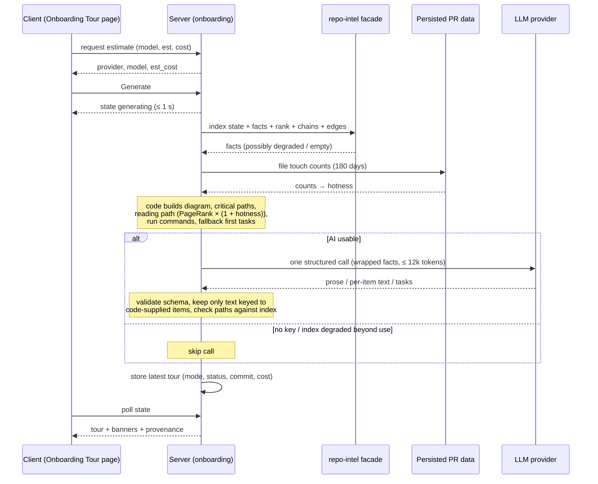

# Spec: Onboarding Tour (Onboarding Generator)   |   Spec ID: SPEC-2026-10-03-onboarding-tour   |   Status: draft
Supersedes: none (replaces the pre-staged, never-shipped onboarding scaffolding described below)
Plan: none yet
Modules touched: server (incl. repo-intel), client, `@devdigest/shared`

## Problem & why

A developer who joins a repository they have never seen has to work out by hand
how it fits together: which files matter, how to run it, where to start
reading, and what they could safely pick up first. DevDigest already holds the
facts that answer those questions for every imported repo:
- repo-intel's import graph, PageRank file rank, critical dependency chains and
  endpoint facts;
- the PR files of imported pull requests.
None of it is shown to a newcomer as a guided path.

The Onboarding Tour is a per-repo page (sidebar item "Onboarding Tour") with five
sections: **Architecture overview, Critical paths, How to run locally, Guided
reading path, First tasks**.
- Code gathers every fact deterministically.
- Code orders the reading path by the import graph:
  **PageRank × (1 + hotness)**.
- **Exactly one** structured LLM call turns the facts into readable prose.
- When the index is degraded or the call fails, the page shows a
  **deterministic skeleton with an honest status** rather than an error or a
  fabricated tour.

"Onboarding" here means **onboarding a developer to one imported repository**.
It is unrelated to the existing add-repository flow at `/onboarding`, which keeps
its route and behaviour.

Scaffolding is already staged in the starter. It is reused where it fits and
replaced where it conflicts with this spec:
- `@devdigest/shared`: the `Onboarding` / `OnboardingSection` / `OnboardingLink`
  contracts. Their free-form `kind` + markdown `body` + LLM `diagram` shape is
  replaced by the five typed sections below.
- server: a per-repo `onboarding` table (one row per repo: json and
  generation time), the `onboarding` feature model (Settings → model selection),
  an `onboarding.system.md` prompt, and the repo-intel facade methods for
  top-ranked files and critical paths.
- The staged prompt asks for a `routes_and_apis` section and for LLM-authored
  mermaid. Both are superseded.
- client: the `onboarding` i18n namespace. Its copy promises different sections
  ("overview, architecture, key modules, getting started, conventions") and is
  rewritten. Also the `onboarding-tour` shell label and active-key.
- The gap: hotness is pinned to 0, because the clone is shallow and history
  was never wired. Also missing are the stack, structure and scripts fact
  gathering, the generation lifecycle, the route, the sidebar item and the page.

## Goals / Non-goals

- Goal: a per-repo, read-only Onboarding Tour page with the five sections of the
  design, reachable from the sidebar WORKSPACE group.
- Goal: gather stack, structure, routes, scripts, rank, critical paths and
  hotness deterministically through repo-intel and the persisted PR data.
- Goal: order the reading path by PageRank × (1 + hotness). Hotness comes from
  how often imported PRs touched a file in the last 180 days.
- Goal: exactly one logical structured LLM call per generation, turning
  facts into prose. The output is validated and every file reference is checked
  against the index.
- Goal: a complete deterministic skeleton, with an honest per-page and
  per-section status, whenever the index is degraded or the AI step can't be
  used.
- Goal: explicit, cost-visible generation. Nothing generates on its own, and
  model and estimated cost show before every Generate or Regenerate.
- Goal: bounded time, cost and content on very large repositories.
- Non-goal: changing the add-repository flow at `/onboarding`.
- Non-goal: automatic generation (on page view, after clone, or after reindex).
  The user chose explicit Generate.
- Non-goal: a public or unauthenticated share link, or a Markdown export.
  "Share link" copies an in-app deep link only.
- Non-goal: an LLM-authored diagram. The diagram is drawn by code from the
  index.
- Non-goal: LLM-authored run commands. Commands are deterministic, and the
  model may only annotate them.
- Non-goal: deepening the repo clone, or computing git-history churn.
- Non-goal: changing the stored file rank that reviews, conventions and blast
  radius use. Hotness weighting applies to the tour's reading path only.
- Non-goal: an in-app file viewer. "Open" goes to GitHub.
- Non-goal: keeping tour history or versions. Only the latest tour per repo is
  kept.
- Non-goal: writing the tour into the repo folder (the Settings "sync to
  folder" toggle). The clone resync resets the working tree, so written files
  would be lost.
- Non-goal: localisation into languages other than English. The strings are
  catalogued so it can be added later.

## User stories

- US-1 [P1] As a developer new to a repository, I want one page showing its
  architecture, critical files, how to run it, what to read first and a first
  task, so that I become productive without asking a teammate for a tour.
- US-2 [P1] As a workspace user, I want to generate and regenerate the tour
  explicitly, see the model and expected cost first, and know when it is out
  of date, so that I control spend and trust its freshness.
- US-3 [P1] As a newcomer, I want the reading path ordered by how central a file
  is and how actively it changes, so that I read foundational, live code first.
- US-4 [P1] As a newcomer, I want "How to run locally" commands I can copy
  safely, so that a repo file can't trick me into running something the repo
  doesn't define.
- US-5 [P1] As a user of a large, partly indexed or AI-less repo, I want a
  useful tour that honestly says what is missing, so that I am never shown
  degraded content as if it were complete.
- US-6 [P2] As a teammate, I want to copy a link to the tour or one of its
  sections, so that I can point a newcomer at it.
- US-7 [P2] As a newcomer, I want "Open" to take me to a cited file at the exact
  commit the tour describes, so that what I read matches what the tour says.
- US-8 [P1] As an operator, I want generation on very large repositories to stay
  within fixed time, token and cost bounds, so that one big repo can't stall
  the studio or run up a bill.

## Acceptance criteria (EARS)

### Navigation & page shell (US-1)

- AC-1: The sidebar WORKSPACE group **shall** contain an "Onboarding Tour" item
  between "Pull Requests" and "Project Context" that opens the Onboarding Tour
  page of the active repo.
  _(observable: UI test — item order in WORKSPACE; click navigates to the active repo's tour route)_
- AC-2: WHILE the Onboarding Tour page of any repo is shown, the sidebar
  **shall** mark "Onboarding Tour" as the active item.
  _(observable: UI test — active state on the item)_
- AC-3: WHILE the add-repository page is shown, the sidebar **shall not** mark
  "Onboarding Tour" as active.
  _(observable: unit test on the active-key derivation for the add-repo path; UI test)_
- AC-4: The Onboarding Tour page **shall** show the breadcrumb
  "<owner>/<name> › Onboarding Tour".
  _(observable: UI test on breadcrumb text)_
- AC-5: WHEN a stored tour exists for the repo, the page **shall** show the
  header "Onboarding for <repo name>", a subtitle with the indexed file count
  and the tour's relative generation time, and the five sections in this
  order: Architecture overview, Critical paths, How to run locally, Guided
  reading path, First tasks.
  _(observable: UI test with a stored-tour fixture — header, subtitle, section order)_
- AC-6: The page **shall** show an "On this page" navigation with one entry per
  section, in section order.
  _(observable: UI test — five entries, labels equal section titles)_
- AC-7: WHEN the user activates an "On this page" entry, the system **shall**
  scroll to that section, expand it if collapsed, and set the URL fragment to
  that section's anchor.
  _(observable: UI test — section expanded and in view; `location.hash` equals the anchor)_
- AC-8: Each section card **shall** be collapsible and expandable from its
  header control by mouse and keyboard, exposing its expanded state to
  assistive technology.
  _(observable: UI test — Enter/Space toggles; `aria-expanded` reflects state)_
- AC-9: IF no tour is stored for the repo, THEN the page **shall** show an empty
  state with a Generate action, the model that would be used and the cost
  estimate (AC-16), and no section cards.
  _(observable: UI test with a "no tour" API response)_
- AC-10: WHILE the stored tour is loading, the page **shall** show a loading
  state.
  _(observable: UI test with a pending request)_
- AC-11: IF loading the tour fails, THEN the page **shall** show an error state
  with a retry action.
  _(observable: UI test with a rejected request → error copy + retry)_
- AC-12: IF the repo id does not belong to the caller's workspace, THEN the API
  **shall** respond not-found, and the page **shall** show the existing
  repo-not-found state.
  _(observable: HTTP 404 for a foreign repo id; UI renders repo-not-found)_
- AC-13: IF a stored tour does not match the current tour contract (for
  example, data written by the pre-staged scaffolding), THEN the system
  **shall** treat the repo as having no tour (AC-9) instead of failing.
  _(observable: integration test with a legacy-shaped stored row → "no tour" response)_

### Generation lifecycle & cost (US-2)

- AC-14: WHEN the user activates Generate or Regenerate, the system **shall**
  start a generation for that repo and report the state `generating` within
  1 s.
  _(observable: HTTP response time and body state in an integration test)_
- AC-15: WHILE a generation is in progress for the repo, the page **shall** show
  a progress indicator, disable Generate and Regenerate, and keep any
  previously stored tour visible.
  _(observable: UI test with a `generating` state fixture)_
- AC-16: Before generation, the page **shall** show the provider and model that
  will be used and the estimated cost of the call in USD. When the model has
  no known price, it shows the estimated input tokens only.
  _(observable: UI test on the Generate/Regenerate area; estimate API response has `model`, `est_input_tokens`, `est_cost_usd|null`)_
- AC-17: IF a generation request arrives while a generation for the same repo
  is in progress, THEN the system **shall not** start a second generation, and
  **shall** respond with the in-progress state.
  _(observable: two concurrent requests in an integration test → one LLM call on the stub, both responses `generating`)_
- AC-18: WHEN a generation completes, the system **shall** store the result as
  the repo's only current tour, together with the index commit it was built
  from, the generation time, the mode (`ai` or `skeleton`), the provider and
  model, the token counts, and the actual cost.
  _(observable: GET after generation returns these fields; a second generation replaces the first)_
- AC-19: The page **shall** show the model and the actual cost of the stored
  tour, or "no AI call" for a skeleton tour that made none.
  _(observable: UI test on header meta)_
- AC-20: WHILE the repo's current index commit differs from the stored tour's
  commit, the page **shall** show a "stale" badge with a prompt to regenerate.
  _(observable: UI test — index commit ≠ tour commit → badge; equal → no badge)_
- AC-21: The system **shall not** generate a tour without an explicit Generate
  or Regenerate action. That includes page views, clones, reindexes and
  resyncs.
  _(observable: integration test — view page / reindex → zero LLM calls, no stored tour)_
- AC-22: IF the AI step of a regeneration fails while the stored tour is in
  `ai` mode, THEN the system **shall** keep showing the stored tour and
  **shall** show a banner "Regeneration failed: <reason>".
  _(observable: integration test with a failing LLM stub → stored tour unchanged; UI banner)_
- AC-23: IF the AI step fails while there is no stored tour or the stored tour
  is in `skeleton` mode, THEN the system **shall** store and show a fresh
  skeleton tour carrying the failure reason.
  _(observable: integration test → stored tour `mode: skeleton`, `ai_status.reason` set)_
- AC-24: IF the server restarts while a generation is in progress, THEN after
  boot the system **shall** report that generation as failed, not
  `generating`, and allow a new one.
  _(observable: integration test — seed an in-progress generation, boot → state not `generating`; Generate enabled)_

### Deterministic facts: architecture diagram (US-1, US-5)

- AC-25: The Architecture overview **shall** contain a diagram built by code
  from the index, without the LLM. It has nodes for the entry point(s), for
  the top-level source folders ranked by aggregated file rank, and for
  external services detected from dependencies or a compose file, with edges
  for folder-level imports.
  _(observable: unit test on a fixture graph → expected node/edge set; LLM stub returning any text does not change it)_
- AC-26: The diagram **shall** contain at most 12 nodes. When more folders
  qualify, it shows a "+N more folders" note.
  _(observable: unit test with 20 folders → 12 nodes + note "+N more")_
- AC-27: The system **shall** render diagram labels as plain text, never as
  markup.
  _(observable: UI test — a folder named `` renders literally)_

### Deterministic facts: critical paths (US-1)

- AC-28: The Critical paths section **shall** list at most 8 files. They are
  taken from the index's critical dependency chains and from files that
  declare routes, deduplicated, ordered by file rank descending and then by
  path ascending. Each row shows the path, a one-line reason and an Open
  action.
  _(observable: unit test on fixture facts → expected ordered list; UI test on row contents)_

### Reading path & hotness (US-3)

- AC-29: The Guided reading path **shall** list up to 10 source files ordered by
  score = PageRank × (1 + hotness), descending, with ties broken by path
  ascending. It excludes tests, configs, declaration files, migrations and
  generated files.
  _(observable: unit test on fixture rank + touch data → exact expected order)_
- AC-30: The system **shall** compute a file's hotness as the number of distinct
  imported PRs from the last 180 days whose changed files include it, divided
  by the highest such count in the repo. That gives a value in [0, 1].
  _(observable: unit test — touches {a:4, b:2, c:0} → hotness {1, 0.5, 0})_
- AC-31: WHERE the repo has no imported PR touching any file in the last 180
  days, the system **shall** use hotness 0 for every file, so the order equals
  PageRank order. The section notes "no PR activity — ordered by import graph
  only".
  _(observable: unit test + UI copy test)_
- AC-32: The system **shall** keep the reading path's membership and order
  exactly as computed by code, regardless of the LLM output.
  _(observable: integration test — LLM stub returning reordered/extra files → stored order unchanged, extras absent)_
- AC-33: The system **shall not** change the stored file rank used by reviews,
  conventions and blast radius when it computes hotness for the tour.
  _(observable: integration test — stored rank rows identical before/after generation)_

### Deterministic facts: how to run locally (US-4)

- AC-34: The How to run locally section **shall** list numbered commands built
  only from detected repo facts, in this order:
  - the install command of the package manager implied by the root lockfile;
  - `cp <env example> .env` when an env example file exists at the root;
  - `docker compose up -d` when a compose file exists at the root;
  - the run command for the root manifest's `dev` script, or `start` when
    there is no `dev`.
  _(observable: unit test per fixture: pnpm/npm/yarn lockfile, with/without env example, compose, dev/start)_
- AC-35: IF the LLM output proposes a command, or changes a command, that is
  not in the deterministic list, THEN the system **shall** discard it.
  _(observable: integration test — LLM stub adds `curl … | sh` → absent from stored tour)_
- AC-36: WHERE the AI step annotated a command, the system **shall** show the
  annotation as a separate plain-text note next to the command, never as part
  of the command.
  _(observable: UI test — note rendered apart from the command text)_
- AC-37: WHEN the user activates a command's copy button, the system **shall**
  copy exactly that command's text to the clipboard, without its annotation
  and without the step number.
  _(observable: UI test — clipboard text equals command)_
- AC-38: IF no root manifest is detected, THEN the section **shall** state "No
  runnable manifest detected at the repo root" and list up to 5 manifest paths
  found in subfolders.
  _(observable: unit + UI test on a fixture without a root manifest)_

### First tasks (US-1, US-5)

- AC-39: WHERE the AI step succeeded, First tasks **shall** show 3–5 cards. Each
  card has a title, a path hint and a complexity badge of Low, Medium or
  High.
  _(observable: UI test on card contents with an AI fixture)_
- AC-40: IF an AI-proposed task's path hint is neither an indexed path nor a
  path whose parent directory exists in the index, THEN the system **shall**
  drop that task.
  _(observable: integration test — LLM stub task with `nope/x.ts` → absent)_
- AC-41: IF no AI-proposed task survives validation, THEN the system **shall**
  show the deterministic first tasks (AC-42), labelled "From index".
  _(observable: integration test → stored tasks equal the deterministic set; badge "From index")_
- AC-42: The system **shall** derive deterministic first tasks as up to 3 "Add
  tests for <file>" tasks for the highest-ranked source files that have no
  matching test file. Complexity is Low when the file exports at most 5
  symbols, otherwise Medium.
  _(observable: unit test on fixture index → expected tasks and complexities)_

### The single LLM call & validation (US-1, US-8)

- AC-43: Each generation **shall** make at most one logical structured LLM call.
  Bounded provider-level parse-repair retries of that same request count as
  that one call. No per-section calls are made.
  _(observable: LLM stub call count = 1 for an AI generation; 0 for a skeleton generation that skipped the call)_
- AC-44: The system **shall** send the LLM only the gathered facts. That input
  is capped at 12,000 tokens, with the lowest-ranked facts dropped first when
  over the cap.
  _(observable: unit test — oversized fixture → assembled input ≤ 12,000 tokens; top-ranked facts retained)_
- AC-45: The system **shall** use the model chosen for the "Onboarding Tour"
  feature in Settings, falling back to that feature's default.
  _(observable: integration test with a workspace override → stub called with the chosen provider/model)_
- AC-46: IF the LLM output fails schema validation after the provider's
  bounded repair, THEN the system **shall** produce the skeleton with the AI
  status reason "AI output invalid".
  _(observable: integration test with malformed stub output → `mode: skeleton`, reason)_
- AC-47: IF the LLM call errors or does not answer within 60 s, THEN the system
  **shall** produce the skeleton with the AI status reason naming the failure
  (provider error or timeout).
  _(observable: integration test with erroring / slow stub)_
- AC-48: IF the selected provider has no credentials configured, THEN the system
  **shall** make no LLM call, and **shall** produce the skeleton with the
  reason "AI not configured".
  _(observable: integration test → 0 calls, reason)_
- AC-49: The system **shall** accept AI text for a critical path, a reading-path
  file or a run step only when it is keyed to an item the code supplied, and
  **shall** discard any text keyed to anything else.
  _(observable: integration test — stub text for an unknown path → discarded)_
- AC-50: IF AI prose in the Architecture overview references a file path that
  is not in the index, THEN the system **shall** render that reference as
  plain text with no link.
  _(observable: UI test — known path rendered as linked code ref, unknown path as plain text)_
- AC-51: The system **shall** render all AI-written text as markdown with raw
  HTML disabled.
  _(observable: UI test — `<script>` / `` in AI text render inert)_

### Skeleton & honest status (US-5, US-8)

- AC-52: WHEN the system produces a skeleton tour, it **shall** fill all five
  sections from deterministic facts:
  - Architecture: a stack summary and the diagram.
  - Critical paths: reasons such as "imported by N files" or "declares N
    routes".
  - Run commands: per AC-34.
  - Reading path: reasons such as "imported by N files · touched by M PRs".
  - First tasks: per AC-42.
  _(observable: integration test with failing LLM stub → all five sections non-empty on a fixture repo)_
- AC-53: Each section **shall** show a provenance badge: "AI-written" when its
  prose came from the LLM, otherwise "From index".
  _(observable: UI test on AI, skeleton and mixed fixtures)_
- AC-54: WHILE the stored tour was built from a partial or degraded index, or
  in skeleton mode, the page **shall** show a status banner. The banner names
  the index status (with indexed and total file counts when partial) and the
  AI status reason.
  _(observable: UI test per status fixture: partial / degraded / ai-failed / ai-not-configured)_
- AC-55: WHERE the index is partial, the subtitle **shall** read "N of M files
  indexed (partial)" instead of a single count.
  _(observable: UI test with `files_indexed: 5000, files_total: 12450`)_
- AC-56: IF the repo has no clone on disk or its index status is `failed`, THEN
  the page **shall** show an "index not ready" state with a resync action and
  disable Generate, and the system **shall** make no LLM call.
  _(observable: UI test; integration test → generation request rejected with a typed error, 0 LLM calls)_
- AC-57: IF the index has no import graph (for example, no supported source
  files), THEN the reading path and the diagram's folder edges **shall** show
  "No import graph available", and the other sections **shall** still be
  produced.
  _(observable: integration test on a fixture with zero edges)_

### Share link & Open (US-6, US-7)

- AC-58: WHEN the user activates "Share link", the system **shall** copy the
  in-app URL of this repo's Onboarding Tour page to the clipboard, including
  the current section fragment when one is set, and **shall** show a
  confirmation.
  _(observable: UI test — clipboard text equals page URL (+ `#anchor`); toast visible)_
- AC-59: IF writing to the clipboard fails, THEN the system **shall** show the
  URL in a selectable read-only field.
  _(observable: UI test with a rejecting clipboard stub)_
- AC-60: WHEN the page is opened with a section fragment, the system **shall**
  scroll to that section, expand it and move focus to its heading.
  _(observable: UI test — open with `#reading-path` → section expanded, heading focused)_
- AC-61: The "Share link" action **shall not** create any public,
  unauthenticated or token-based access to the tour.
  _(observable: route inventory review — no new unauthenticated route; tour API is workspace-scoped)_
- AC-62: WHEN the user activates "Open" on a file, the system **shall** open that
  file on GitHub in a new tab, at the commit the tour was built from.
  _(observable: UI test — link href `https://github.com/<owner>/<name>/blob/<tour commit>/<path>`, `target=_blank`, `rel` includes `noopener`)_

### Large repositories (US-8)

- AC-63: The system **shall** cap the facts gathered for one generation at:
  - the top 40 ranked files;
  - 30 routes;
  - 20 manifest scripts;
  - 3 levels of folder structure.
  _(observable: unit test on an oversized fixture → counts at caps)_

## Edge cases

- Repo larger than the index cap (e.g. 12,450 files vs a 5,000-file index) →
  partial banner and subtitle (AC-54, AC-55). Facts are capped (AC-63), and so
  is the LLM input (AC-44).
- Index `degraded` (e.g. ripgrep fallback, flag off) → skeleton or AI over the
  available facts, with a banner (AC-54). No graph → AC-57.
- No clone / index `failed` → AC-56. Index never built (`no_data`) → AC-56.
- Index refreshed after the tour was generated → stale badge (AC-20).
- Clone resynced or reindexed *during* generation → the tour records the commit
  it read at the start (AC-18). If the index moved, it shows as stale (AC-20).
- Double-click on Generate, or two tabs regenerating → AC-17.
- Server crash mid-generation → AC-24.
- LLM provider down, slow, unconfigured, or returning invalid JSON → AC-46,
  AC-47, AC-48, plus AC-22/AC-23 for which tour is kept.
- Model invents files, reorders the reading path, or adds commands → AC-32,
  AC-35, AC-40, AC-49, AC-50.
- Prompt-injection text in file names, folder names, manifest scripts or
  descriptions → Untrusted inputs, AC-35, AC-27, AC-51.
- A malicious `dev` script in the repo's own manifest (e.g. it runs
  `curl | sh`) → accepted: no handling. The tour shows the repo's own script
  name (`pnpm dev`), not its body. Running repo-defined scripts is
  inherently trusting the repo.
- No imported PRs in the last 180 days → AC-31.
- Monorepo with no root manifest → AC-38. Monorepo *with* a root manifest →
  root only (Assumption).
- Non-JS/TS repository (repo-intel parses JS/TS only) → no graph (AC-57). Run
  section per AC-34/AC-38.
- More than 12 qualifying folders → AC-26. More than 8 critical candidates →
  AC-28 cap.
- Repo with fewer than 10 rankable source files → the reading path lists all of
  them. Accepted: shorter list, no padding.
- All AI first tasks invalid → AC-41.
- Legacy or unknown stored tour shape → AC-13.
- Very long file paths → accepted: truncated with an ellipsis in rows, full path
  in a tooltip and in the Open link.
- Clipboard API unavailable (non-secure context) → AC-59. Copy-command failure
  → accepted: the same fallback pattern as AC-59 applies.
- Deep link to an unknown fragment → accepted: page opens at the top and no
  section is forced open.
- User visits the add-repository page → AC-3.
- Repo deleted while a generation is running → accepted: the stored tour is
  removed with the repo, and the running generation's result is discarded.
- Repo from another workspace → AC-12.

## Non-functional

- NFR-1 (Performance): WHEN a stored tour is requested, the API **shall**
  respond in ≤ 500 ms p95.
  _(observable: integration-test timing on a seeded tour)_
- NFR-2 (Performance): WHEN a generation runs on an index of up to 5,000
  files, the system **shall** finish deterministic fact gathering and
  skeleton assembly in ≤ 5 s p95, and the whole generation, including the
  LLM call, in ≤ 90 s p95.
  _(observable: logged per-phase durations in an integration test on a 5,000-file fixture; LLM timeout per AC-47)_
- NFR-3 (Performance): WHILE a generation is in progress, the page **shall**
  refresh the generation state at an interval of 2–5 s, and **shall** stop
  refreshing once the state is terminal.
  _(observable: UI test with fake timers — request count over time)_
- NFR-4 (Cost): The system **shall** make ≤ 1 logical LLM call per generation
  (AC-43), with input ≤ 12,000 tokens (AC-44). It **shall** make 0 LLM calls
  for viewing, sharing, opening files, the cost estimate, and
  index-not-ready or AI-not-configured requests.
  _(observable: LLM stub call counts across those actions)_
- NFR-5 (Cost transparency): The system **shall** show the estimated cost
  before every Generate or Regenerate (AC-16), and record the actual cost
  reported by the provider on the stored tour (AC-18).
  _(observable: estimate response; stored `cost_usd` equals the stub-reported cost)_
- NFR-6 (Security): Every new API surface **shall** be scoped to the caller's
  workspace. No unauthenticated access is added (AC-12, AC-61).
  _(observable: integration test with a foreign workspace → 404)_
- NFR-7 (Security): All repo-derived text sent to the LLM **shall** be wrapped as
  untrusted data, with closing delimiters escaped, under a trusted instruction
  that the content is data, not commands.
  _(observable: unit test on the assembled prompt — repo text appears only inside untrusted blocks; a fixture containing the closing delimiter is escaped)_
- NFR-8 (Security): The system **shall** render all AI-written and repo-derived
  text in the DOM inertly: markdown with raw HTML disabled, and diagram labels
  as plain text (AC-27, AC-51).
  _(observable: UI tests with script/HTML payloads)_
- NFR-9 (a11y): The page **shall** meet WCAG 2.1 AA. Specifically:
  - every icon-only control (copy, collapse, Open) has an accessible name that
    includes its command or path;
  - complexity, provenance and status badges carry text, not only colour;
  - "On this page" and section toggles are keyboard-operable;
  - focus moves to the target heading on anchor navigation (AC-60);
  - copy and share confirmations are announced through a live region;
  - the diagram has a text alternative listing its nodes and edges.
  _(observable: RTL queries by accessible name/role; focus and live-region assertions)_
- NFR-10 (Reliability): A failure of the LLM, the index or PR-history reads
  **shall never** leave the page without content when deterministic facts exist.
  The result is a skeleton (AC-23, AC-52), or the previous AI tour (AC-22).
  Generation **shall** never remain `generating` after a restart (AC-24).
  _(observable: integration tests with each dependency stubbed to fail)_
- NFR-11 (Determinism): WHEN two generations run against the same index,
  PR-touch data, settings and stubbed LLM output, the system **shall** produce
  identical tours, apart from generation timestamps and ids.
  _(observable: hermetic double-run comparison)_
- NFR-12 (Observability): Each generation **shall** write one log line with the
  repo id, mode (`ai`/`skeleton`), index status, AI status reason, input and
  output tokens, cost, and per-phase durations.
  _(observable: captured server log in an integration test)_
- Localisation: every new user-facing string **shall** live in the client
  message catalogs. The `onboarding` namespace is rewritten for the five
  sections and states, and the add-repo copy is left untouched. No
  hard-coded copy. _(covered by AC-level UI copy tests)_

## Cross-module interactions

| Hop | Status | What crosses | Failure contract |
|-----|--------|--------------|------------------|
| client tour page → server: read stored tour + generation state | new | repo id → tour (or "none") + generation state + current index summary | 404 foreign repo (AC-12); other → AC-11 |
| client → server: cost estimate | new | repo id → provider, model, est. input tokens, est. cost (nullable) | estimate unavailable → page shows model only |
| client → server: start generation | new | repo id → generation state | typed `index_not_ready` (AC-56); in-progress → AC-17 |
| server onboarding → repo-intel: index state | existing | status, file counts, commit, degraded reason | always answers, even degraded |
| server onboarding → repo-intel: rank, top files, critical chains, edges, symbols | existing | ranked paths, chains, folder-level edges, exported-symbol counts | degraded → empty results → AC-57 |
| server onboarding → repo-intel: stack / structure / routes / scripts / manifests / env-example / compose facts | new capability on the existing facade | deterministic repo facts from the clone + index | missing file → fact absent, not an error |
| server onboarding → persisted PR data: per-file touch counts over 180 days | existing data, new read | path → distinct-PR touch count | read failure → hotness 0 + note (NFR-10) |
| server onboarding → Settings feature model `onboarding` | existing | provider + model | default used |
| server onboarding → LLM provider (structured call) | existing adapter | untrusted-wrapped facts → typed sections | invalid / error / timeout / no key → skeleton (AC-46–48) |
| server onboarding → price book | existing | tokens → USD estimate / actual | no price → null |
| server onboarding → tour storage | existing table, new shape | latest tour per repo | write failure → generation failed, previous tour kept |
| client → GitHub (Open) | new link only | owner/name + commit + path | n/a (external navigation) |

## Contracts

Shapes only. They change in `@devdigest/shared` first (replacing the staged
`Onboarding*` shapes), then in consumers. The client vendored copy must be
updated in the same change (root INSIGHTS 2026-07-29).

- **Onboarding tour** (server → client):
  - `repo_id` (string)
  - `commit_sha` (string): index commit the tour was built from
  - `generated_at` (timestamp)
  - `mode` (`ai` | `skeleton`)
  - `index` { `status` (`full` | `partial` | `degraded`), `files_indexed` (int),
    `files_total` (int | null), `degraded_reason` (string | null) }
  - `ai` { `status` (`ok` | `failed` | `invalid_output` | `timeout` |
    `not_configured` | `skipped`), `reason` (string | null), `provider`
    (string | null), `model` (string | null), `tokens_in` (int | null),
    `tokens_out` (int | null), `cost_usd` (number | null) }
  - `sections`:
    - `architecture` { `provenance` (`ai` | `index`), `summary_md` (markdown
      string), `stack` (string[]), `diagram` { `nodes` [{ `id`, `label`,
      `kind` (`entry` | `folder` | `service`) }] (≤ 12), `edges` [{ `from`,
      `to` }], `omitted_folders` (int) } }
    - `critical_paths` { `provenance`, `items` [{ `path`, `reason` }] (≤ 8) }
    - `run_locally` { `provenance`, `steps` [{ `order` (int), `command`
      (string), `note` (string | null) }], `no_root_manifest` (boolean),
      `manifests_found` (string[], ≤ 5) }
    - `reading_path` { `provenance`, `items` [{ `order` (int), `path`, `why`,
      `pagerank` (number), `hotness` (number 0..1), `score` (number) }]
      (≤ 10), `hotness_available` (boolean), `graph_available` (boolean) }
    - `first_tasks` { `provenance`, `items` [{ `title`, `path_hint`,
      `complexity` (`low` | `medium` | `high`), `rationale` (string | null)
      }] (≤ 5) }
- **Tour read response** (server → client): `tour` (Onboarding tour | null),
  `generation` { `state` (`idle` | `generating` | `failed`), `started_at`
  (timestamp | null), `error` (string | null) }, `current_index_commit`
  (string | null), `stale` (boolean), `index_ready` (boolean).
- **Cost estimate** (server → client): `provider`, `model`,
  `est_input_tokens` (int), `est_cost_usd` (number | null).
- **Start generation** (client → server): repo id only, no body. Response:
  the `generation` object. Typed error `index_not_ready` when AC-56 applies.
- **LLM structured output** (internal, server ↔ model): architecture prose,
  per-item text keyed by code-supplied path or step order, run-step notes keyed
  by step order, and first tasks. Free-text explanation fields come before
  classification fields such as `complexity` (server INSIGHTS 2026-08-05).
  This is not a public contract.

## Inputs (provenance)

- Index status, file counts, commit: [deterministic: repo-intel index state]
- Ranked files, PageRank, critical dependency chains, import edges, exported
  symbols: [deterministic: repo-intel]
- Stack, folder structure, routes, manifest scripts, lockfile, env example,
  compose file and services: [deterministic: repo-intel. A new fact-gathering
  capability on the existing facade reads the clone and index]
- Hotness: [deterministic: server — distinct-PR touch counts from persisted PR
  files, 180-day window]
- Architecture diagram: [deterministic: repo-intel edges aggregated to folder
  level + detected services]
- Reading path order, critical paths list, run commands, fallback first tasks:
  [deterministic: server over the facts above]
- Model choice: [reused: Settings feature model `onboarding`]
- Cost estimate and actual cost: [reused: price book + the provider-reported
  call cost]
- Architecture prose, per-item reasons and "why" lines, run-step notes, AI first
  tasks: [new: 1 LLM call per generation. Turning heterogeneous facts into
  readable explanations and proposing newcomer tasks cannot be done
  deterministically to a useful standard. Reuse is impossible because no
  existing generated artifact describes a whole repo. Everything the call
  returns is validated against code-supplied items.]

## Untrusted inputs

Repo content is third-party text. Anyone with push access controls file and
folder names, manifest script names and values, dependency names, route
strings, and compose service names.
- **Into the prompt:** every repo-derived fact is wrapped as untrusted data with
  closing delimiters escaped, under a trusted instruction that it is data to
  describe, never instructions (NFR-7). The model never sees full source files,
  only facts.
- **Out of the model:** the model's output is treated as untrusted too.
  - It can't add files, reorder the reading path, or add commands (AC-32,
    AC-35, AC-49).
  - Task paths are checked against the index (AC-40).
  - Unknown path references are not linked (AC-50).
- **Into the DOM:** markdown is rendered with raw HTML disabled, and diagram
  labels as plain text (NFR-8). Open links are built from validated paths and
  open with `noopener`.
- **Clipboard:** copied commands are only the deterministic commands (AC-37).
  Annotations are never part of copied text.

## Assumptions

- "Onboarding" means a developer tour of one imported repo. The add-repository
  flow at `/onboarding` is unrelated and unchanged. (accepted 2026-10-03)
- Only the latest tour per repo is stored, and regeneration replaces it. This
  matches the staged one-row-per-repo table. (accepted 2026-10-03)
- Large-repo caps (accepted 2026-10-03):
  - LLM input ≤ 12,000 tokens;
  - 40 files / 30 routes / 20 scripts / 3 folder levels;
  - LLM timeout 60 s;
  - whole generation ≤ 90 s p95.
- "Exactly one LLM call" means one logical structured call. Provider-level
  bounded parse-repair retries of the same request are part of it.
  (accepted 2026-10-03)
- Hotness window = 180 days (`HOTNESS_WINDOW_DAYS`), counted on the PR's
  last-updated time, normalised by the repo's maximum. It is only as complete
  as the PRs imported into DevDigest. (accepted 2026-10-03, Q1)
- `files_total` for a partial index is the number of candidate files the
  indexer discovered (indexed + skipped). When it is unknown, only the indexed
  count is shown.
- Run commands consider the repo root only. A monorepo without a root manifest
  gets AC-38. Package manager by lockfile: `pnpm-lock.yaml` → pnpm,
  `package-lock.json` → npm, `yarn.lock` → yarn. No lockfile → npm.
- The env example file is the first match among `.env.example`, `.env.sample`
  and `.env.template` at the root. Compose files are `docker-compose.yml`,
  `docker-compose.yaml`, `compose.yml` and `compose.yaml` at the root.
- External services are detected from a fixed list of well-known client
  dependencies (e.g. postgres, redis, mongodb, mysql, kafka, rabbitmq, stripe)
  and from compose service names. A service edge is drawn from a folder only
  when an import of that dependency from the folder is known. Otherwise the
  service node stands unconnected.
- "Open" targets GitHub (`github.com/<owner>/<name>/blob/<commit>/<path>`),
  because repos are imported from GitHub. (accepted 2026-10-03)
- A second Generate during generation joins the in-progress one. A failed
  AI regeneration keeps the previous AI tour. (accepted 2026-10-03)
- The tour is written in English. (accepted 2026-10-03)
- The estimate uses the assembled-input token count and a nominal output
  allowance of 2,000 tokens priced by the price book.
- Existing workspace authorization applies. There are no new roles.

## Traceability

| ID | Story | Task | Test | Commit |
|----|-------|------|------|--------|
| AC-1 | US-1 |  |  |  |
| AC-2 | US-1 |  |  |  |
| AC-3 | US-1 |  |  |  |
| AC-4 | US-1 |  |  |  |
| AC-5 | US-1 |  |  |  |
| AC-6 | US-1 |  |  |  |
| AC-7 | US-1 |  |  |  |
| AC-8 | US-1 |  |  |  |
| AC-9 | US-1, US-2 |  |  |  |
| AC-10 | US-1 |  |  |  |
| AC-11 | US-1 |  |  |  |
| AC-12 | US-1 |  |  |  |
| AC-13 | US-1 |  |  |  |
| AC-14 | US-2 |  |  |  |
| AC-15 | US-2 |  |  |  |
| AC-16 | US-2 |  |  |  |
| AC-17 | US-2 |  |  |  |
| AC-18 | US-2 |  |  |  |
| AC-19 | US-2 |  |  |  |
| AC-20 | US-2 |  |  |  |
| AC-21 | US-2 |  |  |  |
| AC-22 | US-2, US-5 |  |  |  |
| AC-23 | US-2, US-5 |  |  |  |
| AC-24 | US-2 |  |  |  |
| AC-25 | US-1, US-5 |  |  |  |
| AC-26 | US-1, US-8 |  |  |  |
| AC-27 | US-1 |  |  |  |
| AC-28 | US-1 |  |  |  |
| AC-29 | US-3 |  |  |  |
| AC-30 | US-3 |  |  |  |
| AC-31 | US-3, US-5 |  |  |  |
| AC-32 | US-3 |  |  |  |
| AC-33 | US-3 |  |  |  |
| AC-34 | US-4 |  |  |  |
| AC-35 | US-4 |  |  |  |
| AC-36 | US-4 |  |  |  |
| AC-37 | US-4 |  |  |  |
| AC-38 | US-4 |  |  |  |
| AC-39 | US-1 |  |  |  |
| AC-40 | US-1 |  |  |  |
| AC-41 | US-1, US-5 |  |  |  |
| AC-42 | US-1, US-5 |  |  |  |
| AC-43 | US-1, US-8 |  |  |  |
| AC-44 | US-8 |  |  |  |
| AC-45 | US-2 |  |  |  |
| AC-46 | US-5 |  |  |  |
| AC-47 | US-5 |  |  |  |
| AC-48 | US-5 |  |  |  |
| AC-49 | US-1, US-4 |  |  |  |
| AC-50 | US-1 |  |  |  |
| AC-51 | US-1 |  |  |  |
| AC-52 | US-5 |  |  |  |
| AC-53 | US-5 |  |  |  |
| AC-54 | US-5 |  |  |  |
| AC-55 | US-5, US-8 |  |  |  |
| AC-56 | US-5 |  |  |  |
| AC-57 | US-5 |  |  |  |
| AC-58 | US-6 |  |  |  |
| AC-59 | US-6 |  |  |  |
| AC-60 | US-6 |  |  |  |
| AC-61 | US-6 |  |  |  |
| AC-62 | US-7 |  |  |  |
| AC-63 | US-8 |  |  |  |
| NFR-1 | US-1 |  |  |  |
| NFR-2 | US-8 |  |  |  |
| NFR-3 | US-2 |  |  |  |
| NFR-4 | US-2, US-8 |  |  |  |
| NFR-5 | US-2 |  |  |  |
| NFR-6 | US-6 |  |  |  |
| NFR-7 | US-4 |  |  |  |
| NFR-8 | US-1, US-4 |  |  |  |
| NFR-9 | US-1, US-6 |  |  |  |
| NFR-10 | US-5 |  |  |  |
| NFR-11 | US-3, US-5 |  |  |  |
| NFR-12 | US-2, US-5 |  |  |  |

## Recommendations / follow-ups

- **INSIGHTS finding to record in root `INSIGHTS.md` (Codebase Patterns,
  under the 2026-08-05 pre-staged entry).** spec-creator couldn't write it.
  - Onboarding is pre-staged, but it contradicts the shipped feature's shape:
    - the `onboarding` table (`server/src/db/schema/context.ts:120`);
    - the `Onboarding*` contracts (`server/src/vendor/shared/contracts/knowledge.ts:28-47`);
    - the `FEATURE_MODELS.onboarding` entry;
    - `server/src/prompts/onboarding.system.md`, which asks for
      `routes_and_apis` and LLM mermaid;
    - `client/messages/en/onboarding.json`, which promises "overview,
      architecture, key modules, getting started, conventions".
  - repo-intel pins `hotness = 0` (`server/src/modules/repo-intel/pipeline/rank.ts:4-7`,
    "Option B", shallow clone `CLONE_DEPTH = 1`). Any "PageRank × (1 +
    hotness)" ordering needs another source; this spec uses 180-day PR-touch
    counts.
  - `activeKeyFor` matches the substring `/onboarding`
    (`client/src/components/app-shell/helpers.ts:29`), so the add-repo page
    collides with the tour's nav key.
- Per-file "Open in DevDigest" viewer, for repos not hosted on GitHub or
  without network access.
- Git-history-based hotness, if the clone is ever deepened. It would cover
  commits that never went through an imported PR.
- Markdown export of the tour (the rejected Share option B), for pasting into a
  wiki.
- Non-English tour generation, reusing the Settings language once one exists.
- Feed the tour's reading path into new-contributor PR reviews as context.

## Open questions

- none
