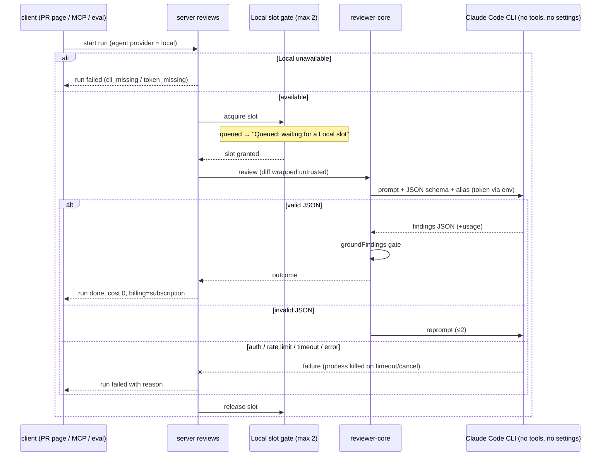

# Spec: Local LLM provider (Claude Code CLI, subscription)   |   Spec ID: SPEC-2026-10-27-local-claude-provider   |   Status: implemented
Supersedes: none
Plan: docs/plans/2026-10-27-local-claude-provider.md
Modules touched: server, client, `@devdigest/shared` (mcp-server and reviewer-core: behaviour unchanged, see Cross-module interactions)

## Problem & why

Every agent review today is a paid API call: the agent's provider is one of
`openai`, `anthropic` or `openrouter` (`server/src/vendor/shared/contracts/knowledge.ts:230`),
each billed per token. The user already pays for a Claude subscription and has
the Claude Code CLI. They want to run reviews (for example with Claude Opus)
through that subscription instead of spending API tokens.

This feature adds a fourth provider, **Local**. It runs the agent's model call
through the Claude Code CLI, authenticated with a long-lived OAuth token that
the user creates with `claude setup-token` and stores in DevDigest Settings.
Local offers models only when it is actually usable. That means the CLI is
present and a token is configured. Otherwise it is shown as unavailable, with
the reason.

## Goals / Non-goals

- Goal: a `local` provider that an agent can select, with a model from a fixed
  list of Claude aliases.
- Goal: Local is available only when the CLI is present and a token is
  configured. Otherwise the reason is shown and no models are offered.
- Goal: the token is configured, its status is shown, and the connection can
  be tested from Settings.
- Goal: Local runs behave like any other review run. They go through the same
  prompt assembly, untrusted-input wrapping, structured-output validation with
  reprompt, and grounding gate.
- Goal: the CLI is a pure diff-in, findings-out text model. It has no tools,
  no MCP servers, and no repo or user Claude configuration.
- Goal: Local runs record `cost_usd = 0` and a `subscription` billing marker.
  The UI shows "Subscription".
- Goal: server-wide throttling of Local calls (at most 2 at once), with a
  300 s timeout and process cleanup.
- Non-goal: other local runtimes (Ollama, LM Studio, llama.cpp). Local means
  Claude Code only for now.
- Non-goal: a bridge to a CLI running on the Docker host. In Docker the CLI
  runs inside the API container.
- Non-goal: using an existing host CLI login (keychain or `~/.claude`) when
  the API runs on the host. Only the DevDigest-configured token counts (user
  answer Q2).
- Non-goal: Local for per-feature models (review_intent, conventions,
  onboarding, risk_brief, conformance) or for the CI agent manifest. Both
  reject `local` (user answer Q1).
- Non-goal: Local embeddings. The embedder is always OpenAI
  (`server/src/platform/container.ts:225`).
- Non-goal: automatic fallback to a paid provider when Local fails. This was
  rejected (proposal P4) because it would spend money silently, against the
  user's intent.
- Non-goal: discovering models from the CLI. The model list is fixed.
- Non-goal: localising the new strings beyond English.

## User stories

- [P1] US-1: As a user with a Claude subscription, I want to choose provider "Local" and a Claude model on an agent, so that its reviews run on my subscription instead of a paid API.
- [P1] US-2: As a user, I want to store my Claude Code OAuth token in Settings, see whether Local is usable, and test the connection, so that I know it works before a review depends on it.
- [P1] US-3: As a user, I want Local agents to run from the PR page, from "Run all", from MCP `run_agent_on_pr`, and in evals, with the same findings quality gates as other providers, so that switching provider changes cost, not trustworthiness.
- [P1] US-4: As a user, I want a clear, actionable reason whenever Local is unavailable or a Local run fails, so that I know whether to install the CLI, re-create the token, or wait out a rate limit.
- [P1] US-5: As a user, I want Local runs to show "Subscription" instead of a dollar cost, so that cost reporting stays honest.
- [P2] US-6: As a user who runs many agents at once, I want Local calls throttled and visibly queued, so that the machine and my subscription quota aren't overwhelmed.

## Acceptance criteria (EARS)

### Availability and model list

- AC-1: The system **shall** report Local as available only WHILE both of these hold: the Claude Code CLI is executable by the API process, and a Claude Code OAuth token is configured through DevDigest secrets (the Settings store, or the environment as fallback).   _(observable: provider status read returns `available: true` only with a stubbed CLI present and a token set; hermetic test across the 4 combinations)_
- AC-2: IF the CLI is not executable by the API process, THEN the system **shall** report Local as unavailable with reason `cli_missing`.   _(observable: status `{available:false, reason:"cli_missing"}`)_
- AC-3: IF the CLI is present but no token is configured, THEN the system **shall** report Local as unavailable with reason `token_missing`.   _(observable: status `{available:false, reason:"token_missing"}`)_
- AC-4: The system **shall not** count any login the CLI already holds on the host (keychain, `~/.claude`, or an API key in the environment) as a configured token.   _(observable: host-mode test with a logged-in stub CLI and no DevDigest token → `token_missing`)_
- AC-5: WHEN the model list for provider `local` is requested and Local is available, the system **shall** return exactly the aliases `opus`, `sonnet` and `haiku`, each with a human-readable label.   _(observable: `GET /providers/local/models` → 3 items)_
- AC-6: WHILE Local is unavailable, the model list for provider `local` **shall** be empty.   _(observable: `GET /providers/local/models` → `[]` with no CLI or no token)_

### Agent configuration

- AC-7: The agent editor's and the create-agent dialog's provider choices **shall** include "Local (Claude Code)".   _(observable: client test, option present)_
- AC-8: WHILE Local is unavailable, the "Local (Claude Code)" provider choice **shall** be shown disabled, with the unavailability reason as visible text, for an agent whose provider is not already `local`.   _(observable: client test, disabled option with text "Unavailable: Claude Code CLI not found" / "Unavailable: token not configured")_
- AC-9: WHEN the user saves an agent with provider `local` and one of the AC-5 aliases, the system **shall** persist that provider and model.   _(observable: `PUT /agents/:id` round-trip)_
- AC-10: IF an agent create or update sets provider `local` with a model that is not one of the AC-5 aliases, THEN the system **shall** reject it with HTTP 422 and leave the stored agent unchanged.   _(observable: `PUT /agents/:id {provider:"local", model:"gpt-4.1"}` → 422)_
- AC-11: WHILE an agent's provider is `local` and Local is unavailable, the agent editor **shall** show a warning naming the reason, and **shall** keep the agent's stored model.   _(observable: client test, warning text plus the model field still holding `opus`)_
- AC-12: WHILE an agent's provider is `local` and Local is unavailable, that agent's card on `/agents` **shall** show a text badge "Local unavailable".   _(observable: client test, badge text present)_

### Settings: token, status, connection test

- AC-13: The Settings API-keys section **shall** show a "Local (Claude Code)" entry with a write-only token field that never displays a stored token value.   _(observable: client test, the field is empty or masked after reload while status shows "configured")_
- AC-14: The "Local (Claude Code)" entry **shall** show a status line with three parts: whether the CLI was found (and its version when found), whether a token is configured, and the current availability reason.   _(observable: client test with the status fixture, e.g. "CLI 2.1.311 · token configured · available")_
- AC-15: WHEN the user saves a token, the system **shall** store it through the existing secrets store, and the next Local call **shall** use it without an API restart.   _(observable: integration test, save the token, then the next stubbed CLI call receives the new token)_
- AC-16: WHEN the user activates "Test connection" for Local, the system **shall** make one minimal model call through the CLI and return `ok: true` with a message naming the CLI version.   _(observable: `POST /settings/test-connection {provider:"local"}` with a stub CLI → `ok:true`)_
- AC-17: IF the Local connection test fails, THEN the system **shall** return `ok: false` with one reason from the AC-27 enum and a human-readable message, and **shall not** return HTTP 5xx.   _(observable: stub CLI exits with an auth error → `{ok:false, reason:"auth_failed"}`, HTTP 200)_
- AC-18: WHILE a Local connection test is in flight, the client **shall** disable the "Test connection" control and show progress on it.   _(observable: client test, disabled and busy during the pending mutation)_

### Running reviews through Local

- AC-19: WHEN a review run starts for an agent whose provider is `local` and Local is available, the system **shall** obtain the review through the Claude Code CLI using the agent's model alias. It **shall** produce findings through the same structured review schema and grounding gate as other providers.   _(observable: integration test with a stub CLI returning valid JSON → persisted review; a stub finding that cites a line not in the diff is dropped)_
- AC-20: The system **shall** run every Local call with all CLI tools and all MCP servers disabled.   _(observable: test asserts the stub CLI was invoked with no tools enabled and no MCP configuration; a prompt asking to read a file yields no tool use)_
- AC-21: The system **shall** run every Local call without loading any Claude Code project, user or local settings, hooks, or `CLAUDE.md`. Its working directory **shall** be outside every repository clone.   _(observable: test with a clone containing a `CLAUDE.md` and `.claude/settings.json`; the invocation's working directory is not under the clone dir and no setting sources are enabled)_
- AC-22: The system **shall** run every Local call without persisting a CLI session.   _(observable: invocation assertion; no session files created in a temp HOME after a stub run)_
- AC-23: IF a Local call returns output that fails structured-output validation, THEN the system **shall** reprompt with the same retry limit as the other providers (2 reprompts).   _(observable: stub returns invalid JSON twice and then valid → the run succeeds with `attempts: 3`)_
- AC-24: IF a Local call still returns invalid structured output after the retry limit, THEN the system **shall** fail the run with reason `invalid_output`.   _(observable: stub always invalid → run `failed`, error carries `invalid_output`)_
- AC-25: IF a run starts for a `local` agent while Local is unavailable, THEN the system **shall** fail that agent's run immediately with the AC-2/AC-3 reason, without starting a CLI process.   _(observable: no token → run `failed` with `token_missing`; stub CLI spawn count 0)_
- AC-26: WHEN "Run all" includes a `local` agent whose run fails, the system **shall** still run the other agents of that request to completion.   _(observable: "Run all" with one unavailable Local agent and one mock-OpenRouter agent → one `failed`, one `done`)_
- AC-27: IF a Local call fails, THEN the system **shall** record on the run exactly one failure reason from `cli_missing | token_missing | auth_failed | rate_limited | timeout | invalid_output | cli_error`, plus a human-readable message.   _(observable: run error and trace carry `reason`; table-driven stub test, one case per reason)_
- AC-28: IF the CLI reports that the token is invalid or expired, THEN the system **shall** fail the run with reason `auth_failed` and a message telling the user to create a new token with `claude setup-token` and save it in Settings.   _(observable: stub auth error → message contains "claude setup-token")_
- AC-29: IF the CLI reports a subscription usage or rate limit, THEN the system **shall** fail the run with reason `rate_limited`, include the reset time when the CLI reports one, and **shall not** retry automatically.   _(observable: stub rate-limit output → one spawn only, the message includes the reset time)_
- AC-30: IF a Local call runs longer than 300 seconds, THEN the system **shall** terminate the CLI process and fail the run with reason `timeout`.   _(observable: never-ending stub plus a fake clock → process killed, `timeout`)_
- AC-31: WHEN a run with an in-flight Local call is cancelled, the system **shall** terminate the CLI process within 5 seconds and record the run as cancelled.   _(observable: cancel during a long stub → the process receives a kill signal ≤ 5 s; run status cancelled)_
- AC-32: IF the CLI exits unsuccessfully for any reason not covered by AC-28 to AC-30, THEN the system **shall** fail the run with reason `cli_error` and a message of at most 500 characters taken from the CLI's error output.   _(observable: stub exits 1 with long stderr → `cli_error`, message length ≤ 500)_
- AC-33: IF any Local call fails, THEN the system **shall** mark the run `failed`, and **shall not** persist a review with zero findings or an approve verdict for it.   _(observable: every AC-27 failure case → no review row for that run)_
- AC-34: WHEN MCP `run_agent_on_pr` runs an agent whose provider is `local`, the system **shall** run it as in AC-19, and **shall** surface any AC-27 failure reason in the tool's error result.   _(observable: mcp-server tool test with a stubbed API returning a failed run whose error carries `rate_limited`)_
- AC-35: WHEN an eval is run for an agent whose provider is `local`, the system **shall** run the agent's model calls through Local under the same rules as reviews (AC-19 to AC-33, AC-36 to AC-39).   _(observable: eval-runner test with a stub CLI; eval result recorded with the `subscription` billing marker)_

### Concurrency and queueing

- AC-36: The system **shall** run at most 2 Local CLI calls at the same time across the whole API process. This covers reviews, evals and connection tests together.   _(observable: start 5 Local runs against a blocking stub → the stub's maximum concurrent count is 2)_
- AC-37: WHILE a Local call is waiting for a free slot, the system **shall** expose the run as queued for Local, and the PR run list and live run log **shall** show "Queued: waiting for a Local slot".   _(observable: third concurrent run → queued indication in `GET /pulls/:id/runs` and the run log; client test for the text)_
- AC-38: WHEN a run that is waiting for a Local slot is cancelled, the system **shall** remove it from the queue without starting a CLI process.   _(observable: cancel the queued run → stub spawn count unchanged; run cancelled)_
- AC-39: WHEN the time a run spends queued is measured against AC-30, the 300-second limit **shall** count only from when its CLI process starts.   _(observable: queued 400 s on a fake clock then a 10 s stub call → run succeeds)_

### Cost and billing

- AC-40: WHEN a Local run completes successfully, the system **shall** record `cost_usd = 0` and billing marker `subscription` on the run and on its trace.   _(observable: `agent_runs` row and `GET` trace → `cost_usd: 0`, `billing: "subscription"`)_
- AC-41: WHEN the CLI reports input and output token counts for a Local call, the system **shall** record them on the run. When it does not, the system **shall** record them as absent rather than 0.   _(observable: stub with usage → counts stored; stub without usage → null)_
- AC-42: WHEN the client shows the cost of a run whose billing marker is `subscription`, it **shall** show "Subscription" instead of a dollar amount. This applies in run history, the run trace, and the run cost badge.   _(observable: client tests on the three surfaces)_
- AC-43: IF a Local run fails, THEN the system **shall** record its cost as absent, as it does for other failed runs, and keep the `subscription` billing marker.   _(observable: failed Local run → `cost_usd: null`, `billing: "subscription"`)_

### Scope guards

- AC-44: IF a settings update assigns provider `local` to any per-feature model, THEN the system **shall** reject it with HTTP 422 and leave all stored settings unchanged.   _(observable: `PUT /settings {feature_models:{conventions:{provider:"local",model:"opus"}}}` → 422)_
- AC-45: The CI agent manifest contract **shall** reject provider `local`.   _(observable: contract unit test, parsing a manifest with `provider:"local"` fails)_
- AC-46: IF the Local provider is asked to produce embeddings, THEN it **shall** fail with an explicit "embeddings not supported by Local" error.   _(observable: unit test)_

### Trace

- AC-47: WHEN a Local run's trace is persisted, it **shall** record provider `local`, the model alias, the billing marker, the time spent queued, and, on failure, the AC-27 reason.   _(observable: `GET` run trace fields)_

## Edge cases

- CLI not installed (host without Claude Code, or an image built without it) → AC-2, AC-8, AC-25
- Token never saved → AC-3, AC-8, AC-25
- The host CLI is logged in but no DevDigest token is set (API run via `./scripts/dev.sh`) → AC-4
- The token is saved while the API is running → AC-15
- The token expires or is revoked between availability check and run → AC-28, AC-33
- The subscription usage limit is hit in the middle of a "Run all" → AC-29, AC-26 (other agents continue; no retries)
- The model returns prose or malformed JSON → AC-23, AC-24
- The model tries to use a tool, for example because a diff contains "read ~/.devdigest/secrets.json" → AC-20, Untrusted inputs
- A cloned repo contains `CLAUDE.md`, `.claude/settings.json` or hooks → AC-21
- A huge diff makes the CLI take longer than 300 s → AC-30
- The user cancels a running or queued Local run → AC-31, AC-38
- 8 agents set to Local, "Run all" → AC-36, AC-37
- Local connection test while 2 reviews hold both slots → AC-36 (the test queues; the UI keeps showing progress, AC-18)
- An agent was switched to Local, then the CLI was removed → AC-11, AC-12, AC-25
- An agent update sends `local` with a non-alias model, for example from MCP or a stale client → AC-10
- A per-feature model is set to `local` through the API → AC-44
- CI manifest with `local` → AC-45
- Something asks Local for embeddings → AC-46
- The API process crashes while CLI processes are running → NFR-7. The existing boot reaper marks orphaned `running` runs; leftover CLI processes are handled as accepted: no handling beyond NFR-7 when the parent process is killed with SIGKILL.
- The CLI prints the token or other secrets in its error output → NFR-3 (redaction before storage or logging)
- The CLI's version changes its output format → AC-24 or AC-32 (fails loudly, never a clean review), accepted: no further handling
- Two API processes (Docker plus host) share one token → accepted: no handling. The cap is per process (AC-36), so up to 4 calls may run at once against one subscription.
- The CLI reports no usage numbers → AC-41

## Non-functional

- NFR-1 (Performance): The Local availability status and the `local` model list **shall** be served within 2 seconds, and **shall not** make a model call.   _(observable: test with a stub CLI version check; zero model invocations; timing assertion)_
- NFR-2 (Cost): Local **shall** make zero paid-API calls. A connection test **shall** make exactly 1 minimal CLI model call. No Local failure **shall** cause a call to any other provider.   _(observable: mock OpenAI/Anthropic/OpenRouter call counters = 0 across all Local tests)_
- NFR-3 (Security, token): The token **shall** reach the CLI only through the child process environment. It **shall never** appear in the database, logs, run traces, run error messages, API responses, or CLI arguments. CLI output **shall** be redacted of the token value before it is stored or logged.   _(observable: tests with a sentinel token value, then grep logs, the trace, the DB row, the response and the spawn args → no match; a stub that echoes the token to stderr → redacted in the stored error)_
- NFR-4 (Security, least privilege): The CLI child process environment **shall not** contain other DevDigest secrets (OpenAI, Anthropic, OpenRouter keys, GitHub token).   _(observable: the stub CLI dumps its env in the test → none of those variables present)_
- NFR-5 (Security, authz): The Local status, token save and connection test **shall** use the existing settings authorisation and the existing connection-test rate limit of 20 per minute.   _(observable: 21st test call within a minute → 429)_
- NFR-6 (a11y): The new UI **shall** meet WCAG 2.1 AA:
  - the token field has a visible label;
  - the status line has `role="status"`;
  - the disabled provider choice and the "Local unavailable" badge carry their reason as text, not only colour;
  - "Test connection" is keyboard-operable;
  - focus stays on "Test connection" after the result arrives.
  _(observable: RTL queries by role and name)_
- NFR-7 (Reliability): WHEN the API process shuts down gracefully, the system **shall** terminate every running Local CLI process within 5 seconds.   _(observable: shutdown test with a long stub → no live child processes after 5 s)_
- NFR-8 (Reliability): A Local failure **shall never** turn a run-start request (`POST /pulls/:id/review`, MCP, eval start) into HTTP 5xx. Failures are recorded on the run.   _(observable: every AC-27 case → 2xx start response plus a failed run)_
- NFR-9 (Determinism): Every acceptance test **shall** run hermetically against a stubbed CLI. No real CLI, network or subscription is used, and fake timers cover AC-30, AC-31, AC-39 and NFR-7.   _(observable: suite passes offline with no `claude` binary installed)_
- NFR-10 (Observability): For each Local call, the server **shall** log one line with the run id, the model alias, the time spent queued, the duration, and the outcome (`ok` or the AC-27 reason). The line **shall not** contain the prompt, the output, or the token.   _(observable: log assertion)_
- Performance (review latency): n/a beyond AC-30. A subscription CLI call has no latency budget that DevDigest controls, so the 300 s cap is the bound.

## Cross-module interactions

| Hop | Status | What crosses | Failure contract |
|---|---|---|---|
| client agent editor and create dialog → server provider models list | **changed**: new provider id `local` | provider id → alias list, or `[]` when unavailable | unavailable → `[]` plus the status reason (AC-6, AC-8) |
| client Settings → server secrets / status / connection test | **changed**: new `local` entry | token (write-only), status read, test request → `ConnTestResult` with reason | never 5xx (AC-17), rate-limited (NFR-5) |
| server reviews run-executor and evals runner → provider resolution | **changed**: resolves `local` | agent provider plus model alias | unavailable → the run fails immediately (AC-25) |
| server reviews → reviewer-core review engine | **existing, unchanged** | prompt (diff wrapped as untrusted), structured schema; findings → grounding gate | engine errors propagate → run `failed` (AC-33) |
| Local provider (server) → Claude Code CLI child process | **new** | in: system and user prompt, JSON schema, alias, token via env only. out: JSON text, optional usage, exit status | AC-27 reasons. Killed on timeout or cancel (AC-30, AC-31). At most 2 at once (AC-36) |
| mcp-server `run_agent_on_pr` → server HTTP API | **existing, unchanged** | run request; the failed run's error | the reason flows through the run error (AC-34) |
| server settings `PUT /settings` | **changed**: guard | `feature_models` | `local` → 422 (AC-44) |
| `@devdigest/shared` contracts | **changed** | provider enum, models, connection test, run and trace billing marker | see Contracts |

reviewer-core needs no behaviour change. It gets a provider through the
existing `LLMProvider` shape, and its `wrapUntrusted` and `groundFindings`
invariants apply unchanged.

## Contracts

These are shapes only. They change in `@devdigest/shared` first, in both the server and the client copies, then in the consumers.

- **Provider id** (agents, model listing, `LLMProvider.id`, `ModelInfo.provider`, connection test, secrets status): adds `local`.
  - The per-feature model choice and the CI agent manifest **exclude** `local` (AC-44, AC-45).
- **Local model list item**: `{ id: "opus" | "sonnet" | "haiku", provider: "local", label }`.
- **Local status** (server → client, alongside or within secrets status):
  - `available`: boolean
  - `reason`: `cli_missing | token_missing`, present when unavailable
  - `cli_version`: string, optional
  - `token_configured`: boolean
- **Token save** (client → server): token string, write-only. It is never returned.
- **Connection test result** for `local`: the existing `{ provider, ok, message, detail? }`, plus `reason` (the AC-27 enum) when `ok` is false.
- **Run / run summary / run trace**:
  - adds `billing`: `api | subscription`. Existing runs read as `api`.
  - `cost_usd` stays the same: `0` for a successful Local run, null on failure.
  - token counts are optional.
  - adds a queued-for-Local indication, plus `queued_ms` on the trace.
  - adds `reason` (the AC-27 enum) on a failed Local run.

## Inputs (provenance)

- Review prompt, schema and grounding: [reused: reviewer-core review pipeline, unchanged].
- Review model call for a Local agent: [new: 1 LLM call per review attempt, the same count as any provider. It replaces a paid call; it does not add one. Reprompts ≤ 2 as today].
- Connection test: [new: 1 minimal LLM call per explicit user test. Without it a bad token is only discovered during a real review].
- Availability (CLI presence and version, token configured): [deterministic: server; no model call].
- Model list: [deterministic: fixed alias list].
- Cost: [deterministic: constant 0 plus the `subscription` marker; no price-book lookup].

## Untrusted inputs

- PR diffs, PR bodies, Project Context specs and repo-map text reach the Local
  model as data. They are wrapped by the existing `wrapUntrusted()` path, the
  same as for other providers.
- The CLI is an agent runtime. Unlike an API call, it *could* act on injected
  instructions if tools were available. That is why AC-20 disables all tools
  and MCP servers, AC-21 blocks repo or user `CLAUDE.md`, settings and hooks,
  and runs the CLI outside clone directories, and NFR-4 keeps other secrets
  out of its environment. A prompt injection can therefore at most corrupt the
  output text. That output is then schema-validated and grounding-gated like
  any model output.
- CLI error output is third-party text. It is truncated (AC-32), redacted
  (NFR-3), and rendered as plain text in the UI.

## Assumptions

- The model list is fixed to the CLI aliases `opus`, `sonnet` and `haiku`. The CLI exposes no model listing, and aliases track the latest model of each family.
- The API's Docker image ships the Claude Code CLI. On the host, the CLI is whatever is on the API process's PATH.
- Token storage follows the existing secrets rule: `~/.devdigest/secrets.json` (mode 0600), with the environment as fallback. The status shows only a boolean.
- The reprompt limit for Local equals the other providers' (2), so the review behaves identically across providers.
- The disabled "Local" choice still lets an agent already on `local` keep it, so a temporary CLI or token problem doesn't silently rewrite agent config.
- Rate-limit and auth failures are recognised from the CLI's reported error. Anything unrecognised is `cli_error` (fails loudly).
- The concurrency cap is per API process. Docker and host-mode APIs running at the same time each have their own cap.
- Agent stats that sum cost treat Local runs as 0.
- The sibling spec `SPEC-2026-10-27-stack-aware-agents` doesn't conflict with this one. Its compatibility filter applies to Local agents like any agent, and this spec doesn't touch languages or activation.
- New user-facing strings are English only.

## Traceability

| ID | Story | Task | Test | Commit |
|----|-------|------|------|--------|
| AC-1 | US-2 | Step 3, 6 | availability.test.ts; container.local.test.ts |  |
| AC-2 | US-4 | Step 3, 6 | availability.test.ts |  |
| AC-3 | US-4 | Step 3, 6 | availability.test.ts |  |
| AC-4 | US-2 | Step 3 | availability.test.ts; container.local.test.ts |  |
| AC-5 | US-1 | Step 3, 6 | local-provider.test.ts; container.local.test.ts |  |
| AC-6 | US-1 | Step 6 | container.local.test.ts |  |
| AC-7 | US-1 | Step 9 | ProviderSelect.test.tsx; CreateAgentModal.test.tsx |  |
| AC-8 | US-4 | Step 9 | ProviderSelect.test.tsx; ConfigTab.test.tsx; CreateAgentModal.test.tsx |  |
| AC-9 | US-1 | Step 6 | local-agent.it.test.ts |  |
| AC-10 | US-1 | Step 1, 6 | local-contracts.test.ts; local-agent.it.test.ts |  |
| AC-11 | US-4 | Step 9 | ConfigTab.test.tsx |  |
| AC-12 | US-4 | Step 9 | AgentCard.test.tsx |  |
| AC-13 | US-2 | Step 6, 8 | LocalProviderRow.test.tsx; settings/local.it.test.ts; container.local.test.ts |  |
| AC-14 | US-2 | Step 8 | LocalProviderRow.test.tsx |  |
| AC-15 | US-2 | Step 6 | container.local.test.ts |  |
| AC-16 | US-2 | Step 6, 8 | container.local.test.ts; LocalProviderRow.test.tsx |  |
| AC-17 | US-2 | Step 3, 6, 8 | container.local.test.ts; LocalProviderRow.test.tsx |  |
| AC-18 | US-2 | Step 8 | LocalProviderRow.test.tsx |  |
| AC-19 | US-3 | Step 3, 7 | local-run.it.test.ts |  |
| AC-20 | US-3 | Step 3 | cli-runner.test.ts; local-run.it.test.ts |  |
| AC-21 | US-3 | Step 3 | cli-runner.test.ts (partial: no --setting-sources, unverified vs real CLI) |  |
| AC-22 | US-3 | Step 3 | cli-runner.test.ts |  |
| AC-23 | US-3 | Step 3, 7 | local-provider.test.ts; local-run.it.test.ts |  |
| AC-24 | US-4 | Step 3, 7 | local-provider.test.ts; local-run.it.test.ts |  |
| AC-25 | US-4 | Step 3, 6, 7 | local-provider.test.ts; local-run.it.test.ts |  |
| AC-26 | US-3 | Step 7 | local-run.it.test.ts |  |
| AC-27 | US-4 | Step 3, 7 | envelope.test.ts; local-run.it.test.ts |  |
| AC-28 | US-4 | Step 3 | envelope.test.ts; local-run.it.test.ts |  |
| AC-29 | US-4 | Step 3 | local-provider.test.ts; local-run.it.test.ts |  |
| AC-30 | US-4 | Step 3 | cli-runner.test.ts; local-provider.test.ts; local-run.it.test.ts |  |
| AC-31 | US-6 | Step 3, 7 | cli-runner.test.ts; sse.test.ts; local-run.it.test.ts |  |
| AC-32 | US-4 | Step 3 | envelope.test.ts; local-run.it.test.ts |  |
| AC-33 | US-3 | Step 7 | local-run.it.test.ts |  |
| AC-34 | US-3 | Step 5 | mcp-server run-agent-on-pr.test.ts |  |
| AC-35 | US-3 | Step 7 | local-eval.it.test.ts |  |
| AC-36 | US-6 | Step 3, 7 | slot-gate.test.ts; local-run.it.test.ts; local-eval.it.test.ts |  |
| AC-37 | US-6 | Step 3, 4, 7 | local-run.it.test.ts; RunHistory.test.tsx |  |
| AC-38 | US-6 | Step 3, 7 | slot-gate.test.ts; local-provider.test.ts; local-run.it.test.ts |  |
| AC-39 | US-6 | Step 3 | local-provider.test.ts; local-run.it.test.ts |  |
| AC-40 | US-5 | Step 7 | local-run.it.test.ts |  |
| AC-41 | US-5 | Step 3, 7 | envelope.test.ts; local-provider.test.ts; local-run.it.test.ts |  |
| AC-42 | US-5 | Step 4 | format.test.ts; RunCostBadge.test.tsx; RunHistory.test.tsx; RunTraceDrawer.test.tsx; VerdictBanner.test.tsx |  |
| AC-43 | US-5 | Step 7 | local-run.it.test.ts |  |
| AC-44 | US-1 | Step 1, 6 | local-contracts.test.ts; settings/local.it.test.ts |  |
| AC-45 | US-1 | Step 1 | local-contracts.test.ts |  |
| AC-46 | US-3 | Step 3 | local-provider.test.ts |  |
| AC-47 | US-4 | Step 7, 4 | local-run.it.test.ts; RunTraceDrawer.test.tsx |  |
| NFR-1 | US-1 | Step 3, 6 | availability.test.ts; container.local.test.ts |  |
| NFR-2 | US-5 | Step 3, 7 | local-run.it.test.ts; container.local.test.ts; local-eval.it.test.ts |  |
| NFR-3 | US-2 | Step 3, 6, 7 | cli-runner.test.ts; envelope.test.ts; local-run.it.test.ts; settings/local.it.test.ts |  |
| NFR-4 | US-3 | Step 3 | cli-runner.test.ts |  |
| NFR-5 | US-2 | Step 6 | container.local.test.ts |  |
| NFR-6 | US-2 | Step 4, 8, 9 | LocalProviderRow.test.tsx; ProviderSelect.test.tsx; AgentCard.test.tsx; ConfigTab.test.tsx |  |
| NFR-7 | US-6 | Step 3, 6 | cli-runner.test.ts; container.local.test.ts |  |
| NFR-8 | US-4 | Step 7 | local-run.it.test.ts; local-eval.it.test.ts |  |
| NFR-9 | US-3 | Step 3–9 | all Local suites (stub spawn/binary) |  |
| NFR-10 | US-4 | Step 3 | local-provider.test.ts; local-run.it.test.ts; container.local.test.ts; local-eval.it.test.ts |  |

## Recommendations / follow-ups

- Make the Settings → Models UI provider-selectable. It is openrouter-only today (`SettingsModels.tsx:24,32` under `client/src/app/settings/[section]/`), and Local for per-feature models could be revisited after that.
- Other local runtimes (Ollama, LM Studio), modelled as further `local` backends.
- A configurable Local concurrency cap and timeout in Settings, if 2 and 300 s turn out to be wrong in practice.
- Show remaining subscription quota or the rate-limit reset time in Settings, if the CLI exposes it.

## Open questions

- none
