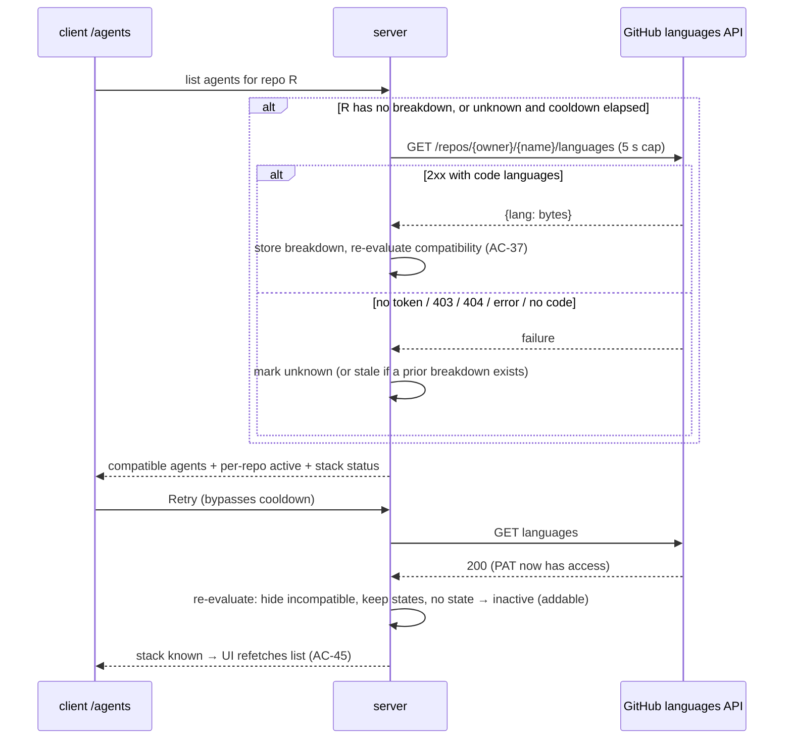

# Spec: Stack-aware agents (agent ↔ repository compatibility) + built-in Python reviewers   |   Spec ID: SPEC-2026-10-27-stack-aware-agents   |   Status: approved
 Supersedes: none
Plan: docs/plans/2026-10-27-stack-aware-agents.md
Modules touched: server, client, mcp-server, `@devdigest/shared`
Amended: 2026-10-27. Per-repo activation is now opt-in: a missing per-repo state means inactive, and new repos and new agents start with nothing active. Decisions made during planning are folded in (see *Assumptions → Resolved during planning*). Re-approved 2026-10-27.

## Problem & why

Every built-in reviewer is written for Node.js. `docs/agent-prompts/general-reviewer.md:2`
and `performance-reviewer.md` say "reviewing a pull-request diff for a Node.js
(TypeScript, ESM) service". `test-quality-reviewer.md` assumes the JS test
tooling. The only gate on an agent is a single workspace-wide `enabled` flag
(`server/src/db/schema/agents.ts:35`). As a result, a user who imports a
Python repository gets Node.js reviewers on Python diffs. "Run all" runs every
enabled agent on every repo (`server/src/modules/reviews/service.ts:50-61`).
The PR "Run review" menu lists every agent, disabled ones included
(`client/src/app/repos/[repoId]/pulls/[number]/_components/RunReviewDropdown/RunReviewDropdown.tsx:50-60`).
The user pays for findings that don't apply, and cannot keep a set of agents
switched on for one repo and off for another.

This feature gives DevDigest a minimal understanding of each repository. That
understanding is the language breakdown GitHub reports for it. Each agent
declares which languages it is for, and agents are then shown and run only
where they apply. Activation becomes per repository. The feature also ships a
Python counterpart for each of the four built-in reviewers.

## Goals / Non-goals

- Goal: store a per-repo language breakdown fetched from GitHub's languages
  API, and show it with percentages and the time it was fetched.
- Goal: let every agent declare its supported languages, either as a list of
  GitHub linguist names or as "any".
- Goal: a deterministic compatibility rule. An agent that is incompatible with
  a repo is never listed for that repo and never runs on it. The client, the
  API, and MCP all enforce this.
- Goal: per-repo activation that replaces the global `enabled` flag. The
  per-repo state of an agent on one repo doesn't affect its state on another.
  Activation is opt-in and manual. The user keeps a workspace-wide list of
  agents and adds specific compatible agents to each repo, and only added
  agents count as active there.
- Goal: when a repo's languages can't be fetched, degrade without blocking
  anything. When a later fetch succeeds, re-evaluate compatibility
  automatically.
- Goal: four built-in Python reviewers (General, Security, Performance, Test
  Quality/pytest). Tag the four existing built-ins as TypeScript/JavaScript.
- Non-goal: a "show all agents regardless of repository" control. The user
  asked for it as future work.
- Non-goal: activating agents automatically. A new repo, a new agent, or an
  agent that becomes compatible after re-evaluation is never made active on
  its own. The user rejected "new repos start with all compatible agents
  active" and chose "empty, I add manually".
- Non-goal: Python support in repo-intel or ast-grep indexing. Indexing stays
  `.ts/.tsx/.js` only (`server/src/adapters/astgrep/index.ts:60`,
  `server/src/modules/repo-intel/constants.ts:14`). Python reviews get the
  degraded, non-AST context the facade already provides.
- Non-goal: detecting the stack from the clone, for example from
  `pyproject.toml` or `package.json`. The source is GitHub's languages API
  only. The Onboarding Tour's planned `stack` fact
  (`docs/plans/2026-10-03-onboarding-tour.md`, step 3) is not reused here.
- Non-goal: any time-based or background refresh of languages.
- Non-goal: changing the review engine (reviewer-core), evals, or the
  Export-to-CI manifest. Evals aren't tied to a repo, so this feature doesn't
  affect them.
- Non-goal: compatibility for skills or Project Context documents.
- Non-goal: localising the new strings beyond English.

## User stories

- [P1] US-1: As a user, I want DevDigest to know which languages each of my repositories is written in, so that agent compatibility rests on real data.
- [P1] US-2: As a user, I want each agent to declare the languages it supports, so that it is matched only to repositories it can review.
- [P1] US-3: As a user, I want an agent that is incompatible with a repository never to run there and never to be listed there, so that I don't pay for irrelevant reviews.
- [P1] US-4: As a user with many agents, I want to add specific compatible agents to a repository, and remove them, per repository, so that only the agents I chose count as active there and my choice on repo A doesn't change repo B.
- [P1] US-5: As a user whose repository's languages can't be fetched, I want reviews to keep working and to see why, and I want compatibility to be corrected automatically once the repository becomes visible.
- [P1] US-6: As a user with a Python repository, I want Python versions of the General, Security, Performance and Test Quality reviewers, so that I get the same review coverage as for Node.js.
- [P1] US-8: As a user, I want each agent card and agent editor to show which languages the agent is for, so that I can tell Node.js and Python agents apart at a glance, even when the name is truncated.
- [P2] US-7: As an MCP client user, I want `list_agents` to report each agent's languages, and its per-repo state when a repo is given, and I want `run_agent_on_pr` to refuse incompatible agents.

## Acceptance criteria (EARS)

### Repository language breakdown

- AC-1: WHEN a repository is added, the system **shall** request that repository's language breakdown from GitHub's languages API, store the language → byte-count map with the time it was fetched, and finish that fetch (within the NFR-1 cap) before responding, so the add response carries the resulting stack.   _(observable: the `POST /repos` response itself has `status: "known"`, a non-empty `languages` map, and `fetched_at` set; hermetic test with stubbed GitHub)_
- AC-2: WHEN the user refreshes a repository through the existing refresh action, the system **shall** re-fetch that repository's language breakdown before responding, replace the stored one if the fetch succeeds, and return the resulting stack in the refresh response.   _(observable: the `POST /repos/:id/refresh` response with a changed GitHub stub has updated `languages` and a newer `fetched_at`)_
- AC-3: WHEN a repository's compatibility is needed and no fetch of its languages has ever been attempted, the system **shall** fetch the breakdown before answering. This applies to listing agents for the repo and to starting a run on one of its PRs.   _(observable: a repo row with no language data; `GET` of the repo-scoped agent list triggers exactly one stubbed GitHub languages call)_
- AC-4: The system **shall** derive a repository's language percentages from the stored byte counts after removing the non-code languages Dockerfile, Shell, Makefile, HTML, CSS, SCSS, Batchfile, PowerShell, Procfile and Jupyter Notebook. Each percentage is a language's bytes divided by the remaining total.   _(observable: unit test, `{Python: 900, Shell: 5000, TypeScript: 100}` → Python 90%, TypeScript 10%)_
- AC-5: IF the languages fetch fails because no GitHub token is configured, THEN the system **shall** mark the repository's stack `unknown` with reason `no_token`.   _(observable: no secret in the stub → `status: "unknown", reason: "no_token"`)_
- AC-6: IF the languages fetch returns HTTP 403 or 404, THEN the system **shall** mark the repository's stack `unknown` with reason `no_access`.   _(observable: stub returns 403 → `reason: "no_access"`; same for 404)_
- AC-7: IF the languages fetch fails with a network error, a timeout, or any other non-2xx status, THEN the system **shall** mark the repository's stack `unknown` with reason `unreachable`.   _(observable: stub throws or times out → `reason: "unreachable"`)_
- AC-8: IF the languages fetch succeeds but no code languages remain after the AC-4 exclusions, THEN the system **shall** mark the repository's stack `unknown` with reason `no_code_languages`. This covers an empty map as well. It also applies to a repository that already had a successful breakdown: the old breakdown is replaced, and the stack is not reported as `stale`.   _(observable: stub returns `{}` or `{Shell: 10}` → `reason: "no_code_languages"`; a `known` repo refreshed against `{}` → `status: "unknown"`, empty `languages`)_
- AC-9: IF a languages fetch fails for a repository that already has a successful breakdown, THEN the system **shall** keep using the last successful breakdown for compatibility and **shall** report the failure reason alongside it.   _(observable: known repo, then refresh with a 403 stub → `languages` unchanged and `status: "stale"` with `reason: "no_access"`; compatibility unchanged)_

### Agent language declaration

- AC-10: The system **shall** store for every agent a language declaration that is either `any` or a non-empty list of GitHub linguist language names.   _(observable: `GET /agents/:id` returns `languages`)_
- AC-11: WHEN an agent is created without a language declaration, the system **shall** record its declaration as `any`.   _(observable: `POST /agents` without `languages` → `languages: "any"`)_
- AC-12: WHEN the user edits an agent's languages in the agent editor's Languages field and saves, the system **shall** persist the new declaration.   _(observable: client test plus `PUT /agents/:id` round-trip)_
- AC-13: WHEN an agent's language declaration changes, the system **shall** bump the agent's version, as it does for other config changes.   _(observable: `version` increments; a new `agent_versions` row includes `languages`)_
- AC-14: IF an agent update supplies an empty language list, more than 20 names, or a name longer than 50 characters, THEN the system **shall** reject the update with HTTP 422 and error code `validation_error` (the app-wide validation convention), and leave the stored declaration unchanged.   _(observable: `PUT /agents/:id` → 422 `validation_error`)_

### Compatibility rule

- AC-15: WHILE a repository's stack is `known` or `stale`, the system **shall** treat an agent as compatible with it if the agent declares `any`, or if at least one declared language, matched case-insensitively, has a percentage of 10% or more under AC-4.   _(observable: unit test, `[TypeScript, JavaScript]` vs Python 90% / TS 10% → compatible; vs Python 95% / TS 5% → incompatible)_
- AC-16: WHILE a repository's stack is `unknown`, the system **shall** treat every agent as compatible with that repository.   _(observable: unknown repo → repo-scoped agent list contains every agent)_
- AC-17: The system **shall** evaluate compatibility from the repository's current stored breakdown and the agent's current declaration each time an agent list is served or a run is requested. It **shall not** use a value computed earlier.   _(observable: change an agent's languages → the next repo-scoped list reflects it without a refresh)_

### Per-repository activation

- AC-18: The system **shall** hold an active/inactive state per pair of repository and agent. This state replaces the agent's workspace-wide `enabled` flag.   _(observable: adding an agent on repo A leaves repo B's state for the same agent unchanged)_
- AC-18a: The system **shall** treat a repository and agent pair that has no stored per-repo state as inactive. Activation is opt-in.   _(observable: an agent with no state row for repo R → `active: false` in R's list and not run by `{all:true}` on R's PRs)_
- AC-19: WHEN the feature's migration runs, the system **shall** give every existing repository and agent pair the agent's previous global `enabled` value as its per-repo state.   _(observable: migration integration test, an agent with `enabled=false` → inactive on every existing repo; an agent with `enabled=true` → active on every existing repo)_
- AC-20: WHEN a repository is added, the system **shall** leave every agent inactive on it. No agent is activated automatically, and the user adds agents to it manually (AC-22).   _(observable: new repo → every listed agent `active: false`; `POST /pulls/:id/review {all:true}` on its PR → empty `runs`)_
- AC-21: WHEN an agent is created, the system **shall** leave it inactive on every repository. On each repository it is compatible with, it is listed as inactive and can be added there.   _(observable: new agent → `active: false` in each compatible repo's list; no per-repo state created)_
- AC-22: WHEN the user activates "Add" on an agent card in the "Available to add" section, or "Remove" on an agent card in the "Active on <repo>" section, of the `/agents` page, the system **shall** make that agent active, or inactive, on the active repository only.   _(observable: Add on repo A, switch the shell to repo B → B's state unchanged; the card moves to the other section on A)_
- AC-22a: The `/agents` page **shall** show the compatible agents in two sections: "Active on <repo full name>", holding the agents active on the active repository, each with a "Remove" button, and "Available to add", holding the compatible inactive agents, each with an "Add" button. There is no per-card toggle.   _(observable: client test, a repo with one active agent → it is under "Active on …" with "Remove"; the other compatible agents are under "Available to add" with "Add"; no `switch` role present)_
- AC-23: WHEN an Add or Remove request fails, the client **shall** return the card to the section it was in before and show an error message.   _(observable: client test with a failing mutation)_
- AC-23a: WHILE an Add or Remove request for an agent is in flight, the client **shall** disable that card's Add/Remove button and show progress on it.   _(observable: client test, the button is disabled with a busy indicator during the pending mutation)_
- AC-24: WHEN a repository or an agent is deleted, the system **shall** remove every per-repo state that refers to it.   _(observable: integration test, no orphaned state rows)_

### Visibility and running

- AC-25: WHEN the `/agents` page is shown, the client **shall** list only the agents compatible with the active repository chosen in the shell repo switcher.   _(observable: client test; Python repo → no TypeScript/JavaScript-tagged agents in the grid)_
- AC-25a: WHILE no agent is active on the active repository, the "Active on <repo full name>" section **shall** show the empty-state text "No agents are active on <repo full name> yet. Add the agents you want to run here from Available to add."   _(observable: client test, a repo with no active agents → the empty-state text is in the "Active on …" section and every compatible agent is under "Available to add")_
- AC-26: WHEN the shell's active repository changes, the `/agents` page **shall** re-list agents, and their split into the two sections, for the newly active repository.   _(observable: client test, switching the repo changes the cards in both sections)_
- AC-26a: WHEN the user picks a repository in the shell repo switcher while on the `/agents` page or an agent editor, the client **shall** stay on that page and change only the active repository. Today the switcher navigates to `/repos/<id>/pulls`.   _(observable: client test, picking repo B on `/agents` → the path is still `/agents` and the list is B's)_
- AC-27: The `/agents` page header **shall** show the active repository's name and its code languages with percentages, highest first, plus the time the breakdown was fetched.   _(observable: client test, header text "Python 90% · TypeScript 10%")_
- AC-28: WHILE the active repository's stack is `unknown` or `stale`, the `/agents` page **shall** show a non-blocking notice reading "Stack unknown: <reason>", or "Stack may be outdated: <reason>" when stale, with a Retry action.   _(observable: client test, the notice is present and the grid still renders)_
- AC-29: WHEN the user activates Retry on that notice, the system **shall** re-fetch the repository's language breakdown immediately, regardless of any cooldown.   _(observable: Retry → one stubbed languages call → the notice disappears on success)_
- AC-30: WHILE a Retry fetch is in flight, the client **shall** disable the Retry action and show progress on it.   _(observable: client test, the button is disabled with a busy indicator during the pending mutation)_
- AC-31: WHEN an agent editor is opened by deep link for an agent incompatible with the active repository, the client **shall** open the editor and show a note that the agent is not compatible with that repository.   _(observable: client test; `/agents/<python-agent-id>` with a TS repo active → editor plus note)_
- AC-32: WHEN "Run all" is requested for a PR, the system **shall** run only agents that are active on, and compatible with, that PR's repository.   _(observable: `POST /pulls/:id/review {all:true}` on a Python repo → runs created only for active Python/`any` agents)_
- AC-33: The PR "Run review" menu **shall** list only agents compatible with the PR's repository.   _(observable: client test, TS-tagged agents absent on a Python repo's PR)_
- AC-34: WHILE an agent is compatible with but inactive on the PR's repository, the PR "Run review" menu **shall** show it with an "inactive" hint and **shall** allow running it individually.   _(observable: client test plus the hint text; clicking it starts a single-agent run)_
- AC-35: IF a run is requested for a single agent that is incompatible with the PR's repository, THEN the system **shall** respond with HTTP 409 in the existing error envelope `{ error: { code: "agent_incompatible", message, details } }`, where `details` carries `agent_languages` and `repo_languages`. It **shall not** create any run.   _(observable: `POST /pulls/:id/review {agentId}` → 409 with `error.details.agent_languages` and `error.details.repo_languages`; no `agent_runs` row)_
- AC-36: IF "Run all" finds no agent that is both active and compatible, THEN the system **shall** start no run. The PR "Run review" menu **shall** show "Run all" as muted.   _(observable: API returns an empty `runs` list; client muted state)_

### Re-evaluation after the repository becomes visible

- AC-37: WHEN a languages fetch succeeds for a repository whose stack was `unknown` or `stale`, the system **shall** re-evaluate the compatibility of every agent with that repository against the new breakdown.   _(observable: integration test, unknown repo → successful fetch → repo-scoped list recomputed)_
- AC-38: WHEN a refresh of a `known` repository yields a breakdown whose compatible-agent set differs from the previous one, the system **shall** re-evaluate compatibility in the same way as AC-37.   _(observable: refresh with a changed stub → the list changes accordingly)_
- AC-39: WHEN re-evaluation makes an agent incompatible with a repository, the system **shall** remove it from that repository's agent list and from its PR "Run review" menu, and **shall** exclude it from runs on that repository.   _(observable: unknown → known Python; TS agents disappear and `{all:true}` no longer runs them)_
- AC-40: WHEN re-evaluation finds that an agent which was compatible before is still compatible, the system **shall** keep that agent's per-repo active state unchanged.   _(observable: Python agent added while the stack was unknown stays active, and one removed stays inactive, after it becomes known Python)_
- AC-41: WHEN re-evaluation makes an agent compatible that has no per-repo state on that repository, the system **shall** list it there as inactive and available to add. It **shall not** activate it.   _(observable: an agent created while the repo was incompatible-for-it → listed with `active: false` after the re-evaluation that makes it compatible)_
- AC-42: WHEN re-evaluation makes an agent compatible that already has a per-repo state on that repository, the system **shall** restore that stored state. It doesn't reset it. An agent that was active before it became incompatible is active again, and one that was inactive stays inactive.   _(observable: an active agent hidden by an incompatible breakdown, then compatible again → `active: true`; the same for an inactive one → `active: false`)_
- AC-43: WHEN a PR sync of a repository with stack `unknown` succeeds, the system **shall** also fetch that repository's language breakdown. The PR sync is the existing `POST /repos/:id/poll`.   _(observable: unknown repo + successful poll stub → one languages call → the stack becomes `known`)_
- AC-44: WHILE a repository's stack is `unknown`, the system **shall** retry the languages fetch when compatibility is needed (AC-3 triggers), at most once per 10 minutes per repository.   _(observable: two list calls 1 minute apart → one GitHub call; a third call after 10 minutes → a second GitHub call; fake clock)_
- AC-45: WHEN re-evaluation changes a repository's compatible-agent set, the client **shall** reflect it on the next load of the `/agents` page or the PR "Run review" menu, without a manual page reload once the triggering action completes.   _(observable: client test, the Retry success invalidates the agent list and the cards update)_

### Built-in agents

- AC-46: The system **shall** provide four built-in Python agents named "General Reviewer (Python)", "Security Reviewer (Python)", "Performance Reviewer (Python)" and "Test Quality Reviewer (Python)", each declaring `[Python]`.   _(observable: after seed, `GET /agents` contains the four names with `languages: ["Python"]`)_
- AC-47: The system **shall** seed the built-in agents, the four existing ones and the four Python ones, into every workspace, including existing workspaces and not only the default one, without duplicating an agent that already exists under the same name in that workspace.   _(observable: two workspaces, running the seed twice → exactly one row per built-in name in each workspace)_
- AC-47a: WHEN the feature's migration finds an agent whose name exactly matches one of the four Python built-in names, the system **shall** set that agent's declaration to `[Python]` once. This includes agents created earlier through the API. Their prompt, model and skills stay unchanged, and the seed **shall not** create a second agent of that name.   _(observable: integration test, a pre-existing API-created "General Reviewer (Python)" with no tag → after migration and seed, one row with `languages: ["Python"]` and the original prompt)_
- AC-47b: WHEN the seed finds an existing agent whose name exactly matches one of the four Python built-in names, the system **shall** set its declaration to `[Python]` only if the declaration is still `any`. It **shall never** overwrite a declaration the user has edited.   _(observable: integration test, a "Security Reviewer (Python)" edited to `[Python, Go]` → unchanged after the seed; one still at `any` → `[Python]`)_
- AC-47c: The seed **shall not** create per-repo state for any agent it creates. A newly seeded built-in, the Python ones included, is inactive on every repository until the user adds it (AC-18a), except as set out in AC-47d.   _(observable: existing repo, seed creates "Performance Reviewer (Python)" → no state row; listed `active: false` on Python repos)_
- AC-47d: WHEN the seed creates the demo repository `acme/payments-api`, the system **shall** make the four TypeScript/JavaScript built-ins active on it, so the demo fixture can be reviewed without setup. It **shall not** change existing per-repo state on a re-run.   _(observable: fresh DB + seed → the demo repo's list shows the four TS/JS built-ins `active: true`; remove one, re-seed → still inactive)_
- AC-48: The General Reviewer (Python) system prompt **shall** describe reviewing a diff of a Python 3 codebase, covering correctness, typing/type hints, exceptions, and async (`asyncio`). It **shall not** mention Node.js, TypeScript or ESM.   _(observable: prompt text assertion)_
- AC-49: The Security Reviewer (Python) system prompt **shall** cover Python-specific risks: `eval`/`exec`, unsafe deserialisation (`pickle`, `yaml.load`), `subprocess` with `shell=True`, SQL built by string formatting, SSRF via `requests`, and secrets in code.   _(observable: prompt text assertion)_
- AC-50: The Performance Reviewer (Python) system prompt **shall** cover ORM N+1 queries (Django ORM / SQLAlchemy), blocking calls inside async code, repeated work in hot loops, and needless materialisation of large collections.   _(observable: prompt text assertion)_
- AC-51: The Test Quality Reviewer (Python) system prompt **shall** assess tests written with pytest: fixtures, `parametrize`, `unittest.mock`/`monkeypatch` overuse, missing assertions, and flaky patterns (time, randomness, ordering).   _(observable: prompt text assertion)_
- AC-52: The system **shall** declare the four existing built-in agents (General, Security, Performance, Test Quality Reviewer) as `[TypeScript, JavaScript]` on fresh seeds.   _(observable: fresh seed → `languages: ["TypeScript","JavaScript"]`)_
- AC-53: WHEN the feature's migration runs on an existing database, the system **shall** set `[TypeScript, JavaScript]` on agents whose names exactly match the four existing built-in names, and `[Python]` on agents whose names exactly match the four Python built-in names (AC-47a). Every other existing agent gets `any`.   _(observable: migration integration test; a renamed built-in and a custom agent → `any`; "Security Reviewer (Python)" → `[Python]`)_

### MCP

- AC-54: The MCP `list_agents` tool **shall** return each agent's language declaration.   _(observable: mcp-server tool test, `languages` present per item)_
- AC-55: WHERE `list_agents` is given a repository (id or `owner/name`), the tool **shall** return only agents compatible with that repository, each with its per-repo `active` state.   _(observable: mcp-server tool test with a stubbed API)_
- AC-56: WHERE `list_agents` is called without a repository, the tool **shall** return all agents without any active/enabled field.   _(observable: mcp-server tool test; no `enabled` key)_
- AC-57: IF `run_agent_on_pr` targets an agent incompatible with the PR's repository, THEN the tool **shall** return an error result that carries the API's `agent_incompatible` message.   _(observable: mcp-server tool test, the stubbed 409 → `isError: true` with the message)_

### Language badge

- AC-58: Every agent card on the `/agents` page **shall** show a language badge that lists the agent's declared languages in declaration order, joined by " · ", for example "Python" or "TypeScript · JavaScript".   _(observable: client test, the card for a `[TypeScript, JavaScript]` agent contains a badge with the text "TypeScript · JavaScript")_
- AC-59: WHERE an agent's declaration is `any`, its card **shall** show the badge text "Any language".   _(observable: client test, a custom untagged agent's card shows "Any language")_
- AC-60: The language badge on an agent card **shall** stay fully visible next to the card's Add/Remove button whatever the length of the agent's name. Only the name may be truncated.   _(observable: client test with a 120-character agent name, the badge's full text is present and is not the element that is truncated; visual check in an e2e flow)_
- AC-61: WHEN the agent editor is open, its header **shall** show the same language badge as the agent's card.   _(observable: client test, the editor header for a `[Python]` agent shows "Python")_
- AC-62: WHEN the user saves a change to the Languages field, the language badge in the editor header and on the agent's card **shall** show the new declaration without a page reload.   _(observable: client test, edit `[Python]` → `any`, save → both badges read "Any language")_
- AC-63: IF a declaration lists more than 3 languages, THEN the badge **shall** show the first 3 followed by "+N", and **shall** expose the full list as its accessible name and tooltip.   _(observable: client test, 5 languages → "A · B · C +2" with an accessible name listing all 5)_

## Edge cases

- A mixed repo, for example Python 60% and TypeScript 40%, gets both the Node/TS and the Python agents. → AC-15
- A language just at the threshold (exactly 10%) counts. A language at 9.9% doesn't. → AC-15
- A repo whose bytes are mostly Shell or HTML, with a little Python, has its noise removed before the percentages are computed. → AC-4
- An empty repo, or a repo with only non-code languages. → AC-8, AC-16
- No GitHub token, or a token without access (today's `serhii-bilous/myTube` 403/404 case). → AC-5, AC-6, AC-16, AC-28
- GitHub is offline or times out. → AC-7, NFR-1
- A known repo's refresh fails, so the last good breakdown is kept. → AC-9
- A known repo's refresh succeeds but now has no code languages, for example after everything was deleted. The old breakdown is replaced and the stack becomes `unknown/no_code_languages`, so every agent becomes compatible. → AC-8, AC-16
- A freshly imported repo has no active agents, so "Run all" on its PRs starts nothing until the user adds agents. → AC-20, AC-25a, AC-36
- A newly created custom agent is active nowhere. It shows up as inactive on every compatible repo. → AC-21
- The four Python built-ins seeded after the migration are active nowhere and can be added to Python (or unknown-stack) repos. → AC-47c
- Python agents created through the API before this feature keep the per-repo state that the migration derives from their old `enabled` flag. On TS-only repos they are hidden and never run, whatever that state is. → AC-19, AC-39
- An unknown-stack repo lists every agent as compatible and addable. None is active until the user adds it. → AC-16, AC-18a
- An agent added on an unknown repo that becomes incompatible once the stack is known is hidden and not run. If a later breakdown makes it compatible again, it is active again. → AC-39, AC-42
- The PAT later gains access to myTube, so the stack moves from unknown to known and is re-evaluated automatically on Retry, Refresh, Sync or a cooldown-gated need. → AC-37, AC-43, AC-44, AC-29
- The user adds or removes agents on an unknown repo and the stack then becomes known. The states of agents that are still compatible are kept. → AC-40
- An agent becomes incompatible and then compatible again. Its stored state is restored. → AC-42
- An agent's languages are edited so that it becomes incompatible with the active repo. It disappears from the list on the next load. → AC-17, AC-25
- The user opens a deep link to an incompatible agent's editor. → AC-31
- The editor is the only way to change the languages of a hidden agent. Without the "show all" control, the user has to switch repo or use a deep link. → accepted: no handling (the user deferred "show all")
- A stale client tries to run an agent that just became incompatible. → AC-35
- MCP runs an incompatible agent. → AC-57
- A run that was already started when re-evaluation hides its agent runs to completion. → accepted: no handling (compatibility is checked at request time, AC-17)
- The user clicks Add or Remove on the same agent twice quickly. The button is disabled while the request is in flight. → AC-23a
- Adding or removing happens while a "Run all" request is in flight. That run uses the state at request time. → AC-17
- No repositories are imported yet, so there is no active repo. → see Assumptions
- The user picks another repo in the shell while on `/agents` or in an agent editor. → AC-26a
- A repo or an agent is deleted. → AC-24
- Linguist names differ in case, for example "python" versus "Python". → AC-15
- An agent declares a language GitHub never reports, for example a typo. It is simply never compatible with a known repo. → accepted: no handling (the editor suggests known names, see Assumptions)
- The built-in names were renamed by the user before the migration ran. → AC-53
- The four "(Python)" agents were already created through the API before this feature ships, with no tag. They are tagged `[Python]` rather than duplicated. → AC-47a, AC-53
- Today the only sign of an agent's language is a name suffix, which the card truncates (for example "General Reviewer (Pyth…"). The badge replaces it. → AC-58, AC-60
- An agent declares many languages. → AC-63
- The seed runs on Docker container start (`server/docker-entrypoint.sh`) or by hand. It is idempotent by name. → AC-47
- The user edits a Python built-in's languages and the seed runs again on container start. → AC-47b
- A built-in the user deleted is re-created by the next seed run, as it is today. It comes back inactive everywhere. → accepted: no handling (existing idempotent-by-name behaviour), AC-47c
- A repository has more than 100 languages. → accepted: no handling (GitHub returns them all, and the header shows the top 5 plus "+N")

## Non-functional

- NFR-1 (Performance): The system **shall** abandon a languages fetch after 5 seconds and treat it as `unreachable`. A repo-scoped agent list or run request that triggered a fetch therefore takes at most 5 seconds plus its normal latency.   _(observable: stub that never resolves plus a fake timer → `reason: "unreachable"` at 5 s)_
- NFR-2 (Performance): WHEN the stored breakdown exists, serving the repo-scoped agent list **shall** make zero GitHub calls.   _(observable: a GitHub stub call counter equals 0)_
- NFR-3 (Reliability / rate limit): The system **shall** make at most one GitHub languages request per repository at a time. Concurrent triggers share the in-flight result.   _(observable: two parallel list requests → one stub call)_
- NFR-4 (Reliability): IF the languages fetch fails for any reason, THEN no agent-list, run, or repo endpoint **shall** return HTTP 5xx because of it.   _(observable: failing stub → 200 responses with `unknown`/`stale` status)_
- NFR-5 (Cost): The feature **shall** add zero LLM calls. Stack detection and compatibility are deterministic.   _(observable: `MockLLMProvider` call count unchanged in the integration tests)_
- NFR-6 (Security): The system **shall** never include the GitHub token in API responses, logs, run traces, or the stored language data. Failure reasons are limited to the enum `no_token | no_access | unreachable | no_code_languages`.   _(observable: log/response assertion in tests)_
- NFR-7 (Security / authz): Per-repo agent state, repo language data, and the compatibility check **shall** be scoped to the caller's workspace. A repo or agent id from another workspace yields 404.   _(observable: integration test across two workspaces)_
- NFR-8 (Security): The client **shall** render language names from GitHub as plain text and never as HTML.   _(observable: client test with the language name `` rendered literally)_
- NFR-9 (a11y): The new controls **shall** meet WCAG 2.1 AA:
  - each section has a heading ("Active on <repo full name>", "Available to add"), and each Add/Remove button is a `button` with the accessible name "Add <agent name> to <repo full name>" or "Remove <agent name> from <repo full name>";
  - after Add or Remove completes, focus moves to the same agent's button in its new section;
  - the stack notice has `role="status"`;
  - Retry is reachable and operable by keyboard;
  - focus stays on Retry after it completes;
  - the "inactive" and "not compatible" states carry text, not only colour;
  - the language badge is text and meets 4.5:1 contrast.
  _(observable: RTL queries by role and name)_
- NFR-10 (Determinism): Every acceptance test **shall** run hermetically with a stubbed GitHub languages response and a fake clock for the AC-44 cooldown. Only migration and seed tests use the DB lane.   _(observable: tests pass with no network)_
- NFR-11 (Observability): WHEN a languages fetch completes, the server **shall** log one line with the repo full name, the outcome (`known`/`unknown`/`stale` plus reason), and, when re-evaluation changed compatibility, the number of agents that became compatible and incompatible.   _(observable: log assertion)_
- NFR-12 (Observability): A run's trace **shall** record the repository code languages used for the compatibility decision.   _(observable: the trace includes the languages snapshot)_
- Accessibility of the new Python prompts: n/a (they are not user-facing UI).

## Cross-module interactions

| Hop | Status | What crosses | Failure contract |
|---|---|---|---|
| server repos → GitHub languages API | **new** call, existing Octokit + `GITHUB_TOKEN` via SecretsProvider (`server/src/adapters/secrets/local.ts`) | owner/name → `{language: bytes}` | no token / 403 / 404 / error / timeout → `unknown`/`stale` with reason (AC-5–9). Never a 5xx (NFR-4). |
| server repos (add / refresh) and polling (`POST /repos/:id/poll`) → languages fetch | **new** trigger on existing actions | repo id; add and refresh await the fetch inline (≤ 5 s, NFR-1) and return the stack | a languages failure doesn't fail add, refresh or poll |
| server reviews (`resolveTargets`) → agents + repo stack | **changed**: `all` now means active ∧ compatible on the PR's repo; a single agent is checked for compatibility | repo id, agent ids | incompatible single agent → 409 `agent_incompatible` in the standard error envelope (AC-35) |
| client `/agents` → server (repo-scoped agent list, per-repo Add/Remove, stack retry) | **new** surface | active repo id ↔ agents + `compatible`/`active`, repo stack | list errors use the page's existing error state; a failed Add/Remove is reverted (AC-23) |
| client PR "Run review" menu → server agent list scoped to the PR's repo | **changed** | repo id | as above |
| client agent editor → server agent update | **changed**: adds `languages` | declaration | 422 `validation_error` on invalid input (AC-14) |
| mcp-server `list_agents` / `run_agent_on_pr` → server HTTP API | **changed** | optional repo; 409 error passthrough | API error → `isError` result (AC-57) |
| seed / migration → agents and per-repo state | **changed** | built-in tags (migration once; seed only over `any`), built-ins in every workspace, initial state (migration from `enabled`; seed creates none except the demo repo) | idempotent by name (AC-47, AC-47b–d) |
| client shell repo switcher → `/agents` / agent editor | **changed**: on these pages a pick changes only the active repo | repo id | n/a (client-only) (AC-26a) |

## Contracts

These are shapes only. They change in `@devdigest/shared` first, then in the consumers.

- **Repo stack** (server → client, part of the repo or a repo-scoped read):
  - `status`: `known | stale | unknown`
  - `reason`: `no_token | no_access | unreachable | no_code_languages`. Present when the status is `stale` or `unknown`.
  - `languages`: list of `{ name, bytes, percent }`, code languages only, highest first. Empty when unknown with no prior data.
  - `fetched_at`: timestamp of the last successful fetch. Optional.
  - `last_attempt_at`: timestamp. Optional.
- **Agent** (server ↔ client, MCP):
  - adds `languages`: `"any"` or a non-empty list of strings. Each string is 1–50 characters, at most 20 of them.
  - the global `enabled` field is **removed** from the contract. The stored column stays in place, unused, and is dropped later.
- **Repo add / refresh responses** (server → client): carry the repo stack shape above, as it was after the inline fetch.
- **Repo-scoped agent list item** (server → client):
  - all agent fields;
  - `compatible`: boolean. Always true in this list, since the list is filtered; kept for the deep-link editor read.
  - `active`: boolean for that repo. It is `false` when no per-repo state exists (AC-18a).
- **Per-repo Add / Remove** (client → server): repo id, agent id, `active` boolean (true = Add, false = Remove). The response is the updated item.
- **Stack retry** (client → server): repo id. The response is the updated repo stack.
- **Run request**: unchanged input. Adds the error response `409 { error: { code: "agent_incompatible", message, details: { agent_languages, repo_languages } } }`, which uses the existing error envelope.
- **MCP `list_agents`**:
  - input: optional `repo` (id or `owner/name`);
  - output items: `id, name, description, provider, model, languages`, plus `active` when `repo` is given.

## Inputs (provenance)

- Repo language breakdown: [new: 0 LLM calls; deterministic, GitHub languages API]. The user chose GitHub over the clone.
- Compatibility decision: [deterministic: server], computed from the breakdown and the agent declaration.
- Per-repo active state: [new: user-set state, opt-in, absent = inactive]. For pairs that exist at migration time only, it is initialised from [reused: existing `agents.enabled`].
- Existing built-in prompts: [reused: `server/src/db/seed-prompts.ts` / `docs/agent-prompts/*.md`].
- Python agent prompts: [new: authored prompt text, 0 runtime calls beyond the normal review call per run]. A Node.js prompt can't be reused as-is because it explicitly targets Node.js.
- Python-repo review context: [reused: repo-intel facade degraded/ripgrep path], with no new indexing.

## Untrusted inputs

- GitHub's languages response is third-party data. Only the keys (language names) and integer byte counts are used. Names are shown as plain text (NFR-8), compared as strings, and never put into any prompt.
- Python PR diffs and bodies reaching the new agents go through the existing reviewer-core path. `wrapUntrusted()` and the `groundFindings()` gate apply unchanged. This feature doesn't add a path into prompts.

## Assumptions

- Python agents are seeded for every workspace (AC-47). They stay hidden on non-Python repos and are active nowhere until added (AC-47c), so this is harmless.
- The two sections are ordered "Active on <repo>" first, then "Available to add". Within each section, agents are listed in the page's existing order.
- The demo repo `acme/payments-api` gets the four TS/JS built-ins active when the seed creates it (AC-47d). It is seed fixture data, not a user import, and keeps today's demo and e2e flows that "Run all" on PR #482 working.
- When "Run all" is muted because no agent is active (AC-36), its tooltip reads "No agents are active on this repository. Add them on the Agents page."

### Resolved during planning (2026-10-27)

These deviate from the spec as first approved and are now reflected in the ACs:
- Activation is opt-in. A missing per-repo state means inactive, and new repos and new agents start with nothing active (AC-18a, AC-20, AC-21, AC-41). The user chose "empty, I add manually".
- Invalid languages → HTTP 422 `validation_error`, the app-wide convention, not 400 (AC-14).
- `agent_incompatible` puts `agent_languages` and `repo_languages` in `error.details` of the standard envelope (AC-35).
- On `/agents` or the agent editor, the shell repo switcher only changes the active repo and doesn't navigate (AC-26a).
- `/agents` is split into "Active on <repo>" and "Available to add" sections with Add/Remove buttons. This replaces the per-card toggle (AC-22, AC-22a, AC-23, AC-23a, AC-25a, NFR-9). The user accepted this as Proposal P1.
- The demo repo starts with the four TS/JS built-ins active (AC-47d). The user accepted this as Proposal P2.
- `POST /repos` and `POST /repos/:id/refresh` await the languages fetch inline (≤ 5 s), and the response carries the stack (AC-1, AC-2).
- A successful refresh with no code languages → `unknown/no_code_languages`, which replaces the old breakdown rather than going stale (AC-8).
- The migration does the one-time `[Python]` tagging. The seed tags only when the declaration is still `any` (AC-47a, AC-47b).
- Built-ins are seeded into every workspace (AC-47).
- `agents.enabled` stays in the DB unused and is dropped later. The contract no longer has it (Contracts).

### Other defaults

- Python agents use the same default provider and model as the existing built-ins, keep repo-intel on, and fall back to the facade's degraded context.
- Test Quality Reviewer (Python) is linked to the `pr-quality-rubric` skill only. `test-coverage-nudge` is JS-oriented and is not linked.
- Changing languages is a config change that bumps the agent version (AC-13). Per-repo Add/Remove doesn't bump it, matching how the global toggle behaves today (`server/src/modules/agents/repository.ts:128`).
- The editor's Languages field offers an "Any language" choice plus suggestions drawn from common linguist names (Python, TypeScript, JavaScript, Go, Java, Ruby, Rust, …), and still allows a custom name.
- With no imported repo, `/agents` lists all agents in a single list with no sections and no Add/Remove buttons, and shows the hint "Import a repository to add agents to it".
- "Stale" counts as known for compatibility purposes (AC-9, AC-15).
- The header shows the top 5 code languages and then "+N more".
- In the PR "Run review" menu, the repository is the PR's repo, not the shell's active repo. The two normally coincide.
- Evals and the Export-to-CI path are unaffected: evals have no repo, and CI export is out of scope.
- A failed languages fetch is not shown on the repo list page. It appears only on `/agents` (AC-28).

## Traceability

| ID | Story | Task | Test | Commit |
|----|-------|------|------|--------|
| AC-1 | US-1 | Step 6 | server/test/repos-stack.test.ts | f5664ba |
| AC-2 | US-1 | Step 6 | server/test/repos-stack.test.ts | f5664ba |
| AC-3 | US-1 | Step 4, 5, 6 | server/test/repo-stack-service.test.ts; server/test/reviews-compat.test.ts | f5664ba |
| AC-4 | US-1 | Step 4 | server/test/stack-compat.test.ts | f5664ba |
| AC-5 | US-5 | Step 4 | server/test/repo-stack-service.test.ts | f5664ba |
| AC-6 | US-5 | Step 4 | server/test/repo-stack-service.test.ts; server/test/stack-compat.test.ts | f5664ba |
| AC-7 | US-5 | Step 4 | server/test/repo-stack-service.test.ts | f5664ba |
| AC-8 | US-5 | Step 4 | server/test/repo-stack-service.test.ts; server/test/stack-compat.test.ts | f5664ba |
| AC-9 | US-5 | Step 4 | server/test/repo-stack-service.test.ts; server/test/stack-compat.test.ts | f5664ba |
| AC-10 | US-2 | Step 1, 2, 5 | server/test/agents-repo-scope.test.ts | f5664ba |
| AC-11 | US-2 | Step 5 | server/test/agents-repo-scope.test.ts | f5664ba |
| AC-12 | US-2 | Step 5, 9 | server/test/agents-repo-scope.test.ts; client ConfigTab.test.tsx | f5664ba |
| AC-13 | US-2 | Step 5 | server/test/agents-repo-scope.test.ts | f5664ba |
| AC-14 | US-2 | Step 1, 5 | server/test/stack-aware-http.test.ts; server/test/agents-repo-scope.test.ts | f5664ba |
| AC-15 | US-3 | Step 4 | server/test/stack-compat.test.ts | f5664ba |
| AC-16 | US-5 | Step 4 | server/test/stack-compat.test.ts; server/test/repo-stack-service.test.ts | f5664ba |
| AC-17 | US-3 | Step 4, 5 | server/test/agents-repo-scope.test.ts; server/test/stack-compat.test.ts | f5664ba |
| AC-18 | US-4 | Step 2, 4, 5 | server/test/agents-repo-scope.test.ts; server/test/repo-stack-service.test.ts | f5664ba |
| AC-18a | US-4 | Step 4, 6 | server/test/stack-compat.test.ts; server/test/reviews-compat.test.ts | f5664ba |
| AC-19 | US-4 | Step 2 | server/test/stack-aware-migration.it.test.ts | f5664ba |
| AC-20 | US-4 | Step 6 | server/test/reviews-compat.test.ts | f5664ba |
| AC-21 | US-4 | Step 5 | server/test/agents-repo-scope.test.ts | f5664ba |
| AC-22 | US-4 | Step 5, 8 | client AgentsListView.test.tsx; server/test/agents-repo-scope.test.ts | f5664ba |
| AC-22a | US-4 | Step 8 | client AgentsListView.test.tsx | f5664ba |
| AC-23 | US-4 | Step 7, 8 | client AgentsListView.test.tsx; client lib/hooks/agents.test.tsx | f5664ba |
| AC-23a | US-4 | Step 8 | client AgentsListView.test.tsx | f5664ba |
| AC-24 | US-4 | Step 2 | server/test/stack-aware-migration.it.test.ts | f5664ba |
| AC-25 | US-3 | Step 5, 8 | client AgentsListView.test.tsx; server/test/agents-repo-scope.test.ts | f5664ba |
| AC-25a | US-4 | Step 8 | client AgentsListView.test.tsx | f5664ba |
| AC-26 | US-4 | Step 8 | client AgentsListView.test.tsx | f5664ba |
| AC-26a | US-4 | Step 7 | client app-shell/hooks/useShellContext.test.tsx | f5664ba |
| AC-27 | US-1 | Step 8 | client AgentsListView.test.tsx | f5664ba |
| AC-28 | US-5 | Step 8 | client AgentsListView.test.tsx | f5664ba |
| AC-29 | US-5 | Step 4, 8 | server/test/repo-stack-service.test.ts; client AgentsListView.retry.test.tsx | f5664ba |
| AC-30 | US-5 | Step 8 | client AgentsListView.test.tsx; client AgentsListView.retry.test.tsx | f5664ba |
| AC-31 | US-2 | Step 5, 9 | client agents/[id]/page.test.tsx; client AgentHeader.test.tsx; server/test/agents-repo-scope.test.ts | f5664ba |
| AC-32 | US-3 | Step 6 | server/test/reviews-compat.test.ts | f5664ba |
| AC-33 | US-3 | Step 10 | client RunReviewDropdown.test.tsx | f5664ba |
| AC-34 | US-4 | Step 6, 10 | client RunReviewDropdown.test.tsx; server/test/reviews-compat.test.ts | f5664ba |
| AC-35 | US-3 | Step 6 | server/test/reviews-compat.test.ts; server/test/stack-aware-http.test.ts; client RunReviewDropdown.conflict.test.tsx | f5664ba |
| AC-36 | US-3 | Step 6, 10 | server/test/reviews-compat.test.ts; client RunReviewDropdown.test.tsx | f5664ba |
| AC-37 | US-5 | Step 4 | server/test/reviews-compat.test.ts | f5664ba |
| AC-38 | US-5 | Step 4 | server/test/repo-stack-service.test.ts | f5664ba |
| AC-39 | US-5 | Step 4, 6 | server/test/reviews-compat.test.ts | f5664ba |
| AC-40 | US-5 | Step 4 | server/test/stack-compat.test.ts | f5664ba |
| AC-41 | US-5 | Step 4 | server/test/stack-compat.test.ts | f5664ba |
| AC-42 | US-5 | Step 4 | server/test/stack-compat.test.ts; server/test/repo-stack-service.test.ts | f5664ba |
| AC-43 | US-5 | Step 4, 6 | server/test/repos-stack.test.ts; server/test/repo-stack-service.test.ts | f5664ba |
| AC-44 | US-5 | Step 4 | server/test/repo-stack-service.test.ts | f5664ba |
| AC-45 | US-5 | Step 7, 8 | client AgentsListView.retry.test.tsx | f5664ba |
| AC-46 | US-6 | Step 3 | server/test/seed-stack-aware.it.test.ts | f5664ba |
| AC-47 | US-6 | Step 3 | server/test/seed-stack-aware.it.test.ts | f5664ba |
| AC-47a | US-6 | Step 2, 3 | server/test/stack-aware-migration.it.test.ts; server/test/seed-stack-aware.it.test.ts | f5664ba |
| AC-47b | US-6 | Step 3 | server/test/seed-stack-aware.it.test.ts | f5664ba |
| AC-47c | US-4 | Step 3 | server/test/seed-stack-aware.it.test.ts | f5664ba |
| AC-47d | US-4 | Step 3, 13 | server/test/seed-stack-aware.it.test.ts; e2e 08-agents-sections.flow.json (not run) | f5664ba |
| AC-48 | US-6 | Step 3 | server/test/seed-prompts-python.test.ts | f5664ba |
| AC-49 | US-6 | Step 3 | server/test/seed-prompts-python.test.ts | f5664ba |
| AC-50 | US-6 | Step 3 | server/test/seed-prompts-python.test.ts | f5664ba |
| AC-51 | US-6 | Step 3 | server/test/seed-prompts-python.test.ts | f5664ba |
| AC-52 | US-6 | Step 3 | server/test/seed-stack-aware.it.test.ts | f5664ba |
| AC-53 | US-6 | Step 2 | server/test/stack-aware-migration.it.test.ts | f5664ba |
| AC-54 | US-7 | Step 12 | mcp-server/src/tools/list-agents.test.ts | f5664ba |
| AC-55 | US-7 | Step 12 | mcp-server/src/tools/list-agents.test.ts; mcp-server/src/resolve.test.ts | f5664ba |
| AC-56 | US-7 | Step 12 | mcp-server/src/tools/list-agents.test.ts | f5664ba |
| AC-57 | US-7 | Step 12 | mcp-server/src/tools/run-agent-on-pr.test.ts | f5664ba |
| AC-58 | US-8 | Step 7, 8 | client LanguageBadge.test.tsx; client AgentCard.test.tsx | f5664ba |
| AC-59 | US-8 | Step 7, 8 | client LanguageBadge.test.tsx; client AgentCard.test.tsx | f5664ba |
| AC-60 | US-8 | Step 8, 13 | client AgentCard.test.tsx; e2e 08-agents-sections.flow.json (not run) | f5664ba |
| AC-61 | US-8 | Step 9 | client AgentHeader.test.tsx | f5664ba |
| AC-62 | US-8 | Step 9 | client AgentEditor.languages.test.tsx; client lib/hooks/agents.test.tsx | f5664ba |
| AC-63 | US-8 | Step 7 | client LanguageBadge.test.tsx | f5664ba |
| NFR-1 | US-5 | Step 4 | server/test/repo-stack-service.test.ts | f5664ba |
| NFR-2 | US-1 | Step 4 | server/test/repo-stack-service.test.ts | f5664ba |
| NFR-3 | US-1 | Step 4 | server/test/repo-stack-service.test.ts | f5664ba |
| NFR-4 | US-5 | Step 4, 6 | server/test/repo-stack-service.test.ts; server/test/repos-stack.test.ts | f5664ba |
| NFR-5 | US-1 | Step 6 | server/test/reviews-compat.test.ts | f5664ba |
| NFR-6 | US-1 | Step 1, 4 | server/test/repo-stack-service.test.ts; server/test/stack-compat.test.ts | f5664ba |
| NFR-7 | US-4 | Step 4, 5 | server/test/repo-stack-service.test.ts; server/test/agents-repo-scope.test.ts | f5664ba |
| NFR-8 | US-1 | Step 7, 8 | client LanguageBadge.test.tsx; client AgentsListView.retry.test.tsx | f5664ba |
| NFR-9 | US-4 | Step 7, 8, 9, 10 | client AgentsListView.test.tsx; client AgentsListView.retry.test.tsx; client RunReviewDropdown.test.tsx; client AgentHeader.test.tsx (partial — see open question) | f5664ba |
| NFR-10 | US-3 | Step 4, 5, 6, 7–12 | all suites hermetic; DB lane only migration + seed .it | f5664ba |
| NFR-11 | US-5 | Step 4 | server/test/repo-stack-service.test.ts | f5664ba |
| NFR-12 | US-3 | Step 6 | server/test/run-executor.test.ts | f5664ba |

## Recommendations / follow-ups

- A "show all agents regardless of repository" control. The user deferred it, and it would also make it easier to edit hidden agents.
- Python support in repo-intel or ast-grep, so that Python reviews get AST callers and ranking instead of ripgrep-only context.
- A manifest-based stack fallback, shared with the Onboarding Tour's planned `stack` fact, for repos where GitHub is unreachable but the clone exists.
- Python counterparts for the API Contract reviewer prompt (`docs/agent-prompts/api-contract-reviewer.md`).
- Showing the detected stack on the repo list or the repo switcher.
- A bulk "Add all compatible agents" action on `/agents`, for when a repo needs many agents at once under opt-in activation.

## Open questions

- none
